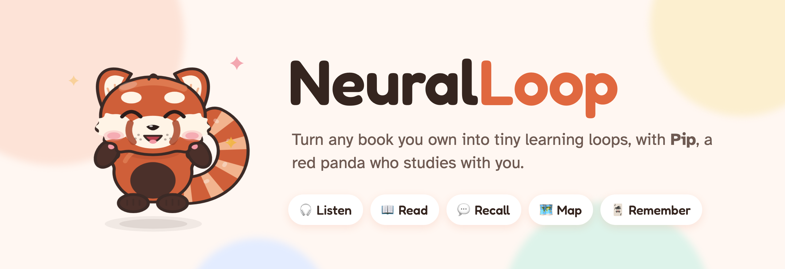
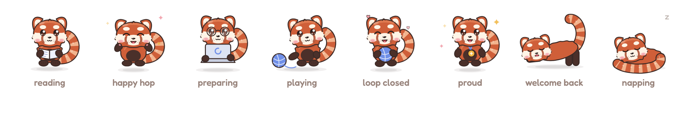

<p align="center">
  <picture>
    <source media="(prefers-color-scheme: dark)" srcset="docs/readme/hero-dark.png">
    
  </picture>
</p>

<p align="center">
  
  
  
  
</p>

<p align="center">
  <b>Drop in a PDF or EPUB. Pip turns every chapter into a rigorous 5-stage mastery loop that makes concepts stick.</b><br>
  <sub>Architectural Briefing · Conversational Active Reading · Socratic Recall · Interactive Verification Sandbox · FSRS-4.5 Spaced Repetition</sub>
</p>

<br>

## 🌸 How a Loop Works

Every chapter is an isolated mastery loop. Chapters unlock sequentially to enforce genuine comprehension.

<table>
  <tr>
    <td align="center" width="20%"><br><b>1 · Prime</b></td>
    <td><b>Architectural Problem Framing</b>: 60-second structural mental model and 2-engineer architectural dialogue (Theo & Ada) framing trade-offs, invariants, and edge cases. Fully textual, instantaneous generation (&lt;2s).</td>
  </tr>
  <tr>
    <td align="center"><br><b>2 · Read (Active Co-Pilot)</b></td>
    <td><b>Conversational Active Reading</b>: Clean typography with an in-situ developer co-pilot. Trigger <i>"Show Me in Code"</i> for instant executable implementations, <i>"Production Reality Check"</i> for failure post-mortems, and inline Socratic margin notes.</td>
  </tr>
  <tr>
    <td align="center"><br><b>3 · Socratic Recall</b></td>
    <td><b>Active Verbal Retrieval</b>: Explain the core mechanism in your own words. An LLM evaluator identifies missing edge cases and misconceptions, followed by an adaptive concept quiz.</td>
  </tr>
  <tr>
    <td align="center"><br><b>4 · Interactive Harness</b></td>
    <td><b>Hands-on Verification Sandbox</b>: Build and test the actual distributed/systems algorithms in an isolated runtime with deterministic virtual clocks, fault injection, and automated test runners.</td>
  </tr>
  <tr>
    <td align="center"><br><b>5 · Remember</b></td>
    <td><b>FSRS-4.5 Spaced Repetition</b>: Mathematically optimal memory retention scheduling with sub-second review cards synced across macOS and iPadOS.</td>
  </tr>
</table>

Closing a loop unlocks the next chapter 🎉. Your **knowledge graph** expands with every chapter mastered.

## ✨ Architectural Highlights

<table>
  <tr>
    <td width="33%" valign="top"><h3>⚡ Uber MCP Gateway</h3>Control Plane Tool Registry + Data Plane Proxy Router. Multi-tenant policy enforcement, circuit breaking, dynamic schema exposure, and zero LLM context bloat.</td>
    <td width="33%" valign="top"><h3>📉 DeepMind Token Optimization</h3>Dynamic schema pruning, response projection, prefix-aligned KV cache templates, and semantic context compaction achieving 60–80% token savings.</td>
    <td width="33%" valign="top"><h3>🧠 Multi-Tier Cognitive Memory</h3>Decoupled episodic history, semantic knowledge graph, procedural execution templates, and continuous vector grounding.</td>
  </tr>
  <tr>
    <td valign="top"><h3>🐾 Native Apple Experience</h3>Pure native macOS 14+ and iPadOS 17+ SwiftUI client with the Pip companion rig, menu bar controls, and fluid interaction.</td>
    <td valign="top"><h3>🔒 Local & Private</h3>Zero telemetry, complete user data sovereignty, local offline model support (Ollama/LM Studio), and private Google Drive sync.</td>
    <td valign="top"><h3>🧪 Verification Sandbox</h3>Deterministic testing harness with <code>VirtualClock</code>, <code>VirtualStorage</code>, and <code>VirtualNetwork</code> for hands-on systems programming.</td>
  </tr>
</table>

## 🐼 Meet Pip

<p align="center">
  
</p>

Pip reads alongside you, celebrates successful test executions, and keeps your learning loop focused without distractions or guilt.

## 🚀 Getting Started

### Architecture & Roadmap
- [plan.md](plan.md) — Complete 6-phase master engineering plan.
- [architecture.md](architecture.md) — Comprehensive High-Level & Low-Level Architecture specifications.
- [docs/ARCHITECTURE.md](docs/ARCHITECTURE.md) — Implementation tour and code contracts.

### Quick Build

```bash
make setup    # Initialize virtual environment and dependencies
make check    # Run full test suite (Python + Swift)
make mac      # Build native macOS app via XcodeGen
```

## 📜 Licensing

Mnemos is source-available under the [PolyForm Noncommercial License 1.0.0](LICENSE).
Pip brand assets and artwork are reserved ([TRADEMARKS.md](TRADEMARKS.md)).
