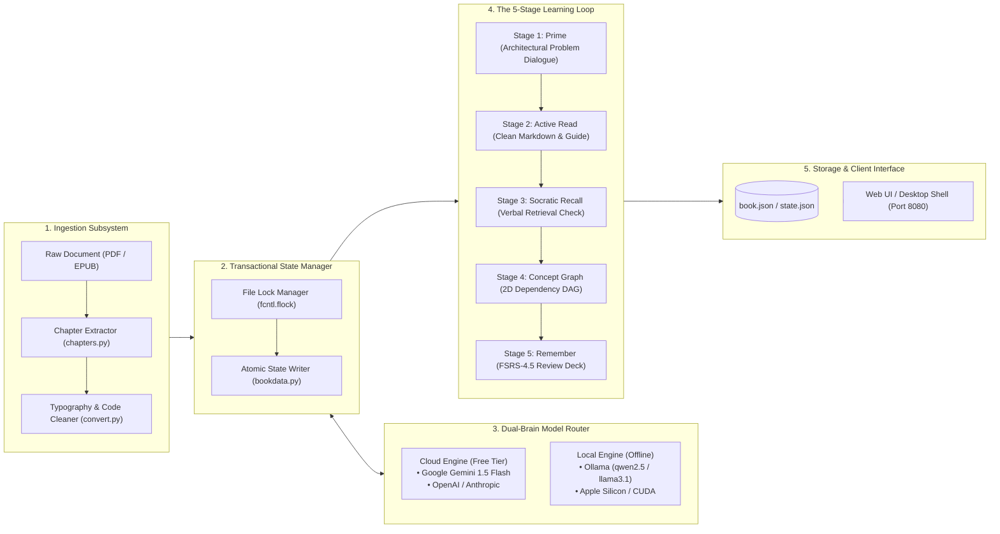
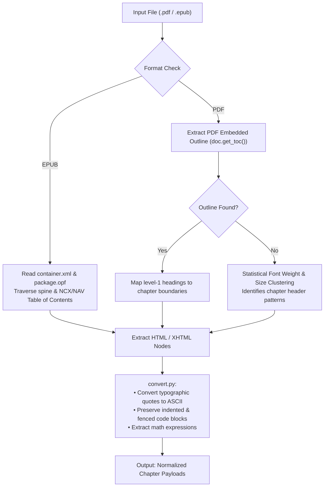
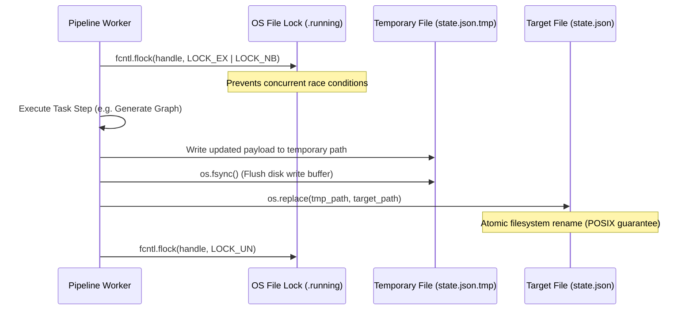
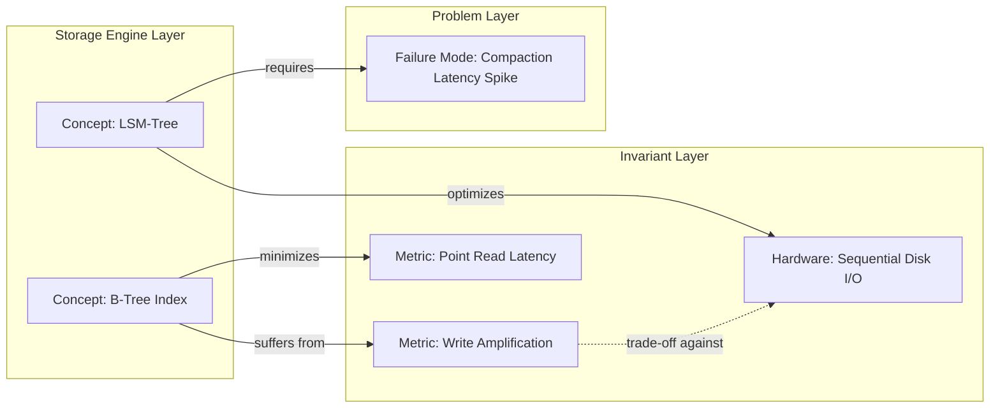
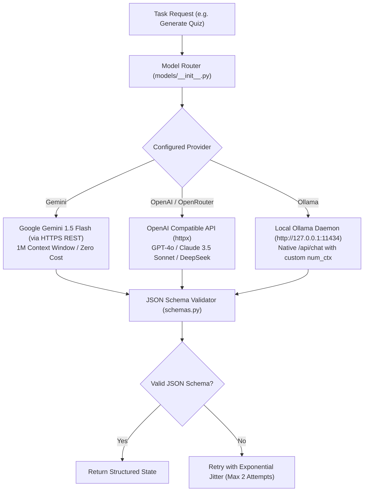
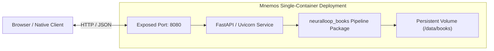

<p align="center">
  <h1 align="center">MNEMOS</h1>
  <p align="center">
    <strong>A High-Retention Technical Learning Engine for Software Engineers</strong><br>
    Transform dense technical literature (PDF/EPUB) into active, structured mastery loops with Socratic evaluation, dynamic concept graphs, and FSRS-4.5 spaced repetition.
  </p>
</p>

---

## 1. Executive Summary & Problem Space

Software engineers regularly purchase dense reference books (e.g., distributed systems, database internals, compilers, network protocols). However, conventional reading suffers from three compounding failures:

1. **The Passive Skimming Trap**: Passive reading exhibits an exponential forgetting curve where over 80% of architectural nuances are lost within 48 hours.
2. **Context Fragmentation in Open-Ended LLMs**: Pasting textbook chapters into general-purpose LLM interfaces produces superficial summaries without structured learning progressions, spatial relationship mapping, or retention mechanisms.
3. **Brittle Generation Bottlenecks**: Contemporary automated learning prototypes rely on neural voice synthesis and video rendering, introducing 8 to 12-minute generation latencies per chapter and platform-specific codec dependencies.

**Mnemos** replaces passive consumption and heavy media pipelines with a lean, deterministic five-stage learning loop executing in under two seconds per chapter.

---

## 2. Core Differentiation Points

Mnemos occupies a distinct architectural space compared to existing tools:

| Dimension | Standard LLM Chat (ChatGPT, Claude) | Standard E-Readers (Kindle, Apple Books) | Traditional Flashcards (Anki) | Mnemos Platform |
| :--- | :--- | :--- | :--- | :--- |
| **Pedagogical Model** | Passive conversational Q&A | Unstructured linear reading | Disconnected fact memorization | **Structured 5-Stage Mastery Loop** |
| **Active Verification** | None; answers queries directly | None; highlight tracking only | Self-reported manual grading | **Automated Socratic Concept Diagnosis** |
| **Structural Context** | Flat context window; loses global map | Linear page index | Isolated atomic cards | **Dynamic Concept Knowledge Graph (DAG)** |
| **Memory Scheduling** | None; ephemeral session | None | Legacy SuperMemo SM-2 math | **FSRS-4.5 Retrievability Optimization** |
| **Generation Latency** | N/A | Instant (Raw File) | Manual creation required | **Instantaneous (< 2.0s per chapter)** |
| **Data Sovereignty** | Hosted cloud; data stored remotely | DRM-locked ecosystem | Local SQLite database | **100% Local-First (Docker / On-Device)** |
| **Operational Cost** | Paid subscription ($20/mo) | Book purchase price | Free / Open-source | **$0 Infrastructure (Free Gemini / Ollama)** |

---

## 3. High-Level Design (HLD)

### 3.1 End-to-End System Architecture



---

### 3.2 The 5-Stage Sequential Progression

Chapters unlock sequentially. A learner cannot advance to Chapter $N+1$ without closing the loop on Chapter $N$:

```
[Document Ingested] ──► [Instant Chapter Split < 2s] ──► [Chapter 1 Loop Active]
                                                               │
  ┌────────────────────────────────────────────────────────────┴───────────────────────────────────────┐
  ▼                                                                                                    ▼
[STAGE 1: PRIME] ──────────────────────────────────────────► [STAGE 2: ACTIVE READ]
• 60s Structural Mental Model                                • High-readability typography
• Two-Engineer Technical Dialogue (Theo & Ada)               • In-situ "deep vs. skim" reading plan
• Focuses strictly on trade-offs and failure modes           • Code blocks and equations preserved verbatim
  │
  ▼
[STAGE 3: SOCRATIC RECALL] ────────────────────────────────► [STAGE 4: CONCEPT GRAPH]
• Active free-text verbal retrieval                          • 2D interactive topological node graph
• Evaluated against invariant rubrics                        • Traverses prerequisite paths and layers
• Probes edge-case misconceptions                            • Reconstructs mental model from memory
  │
  ▼
[STAGE 5: REMEMBER (FSRS-4.5)] ────────────────────────────► [LOOP CLOSED] ──► [Chapter 2 Unlocks]
• Flashcards scheduled on forgetting curve
• Sub-second daily review deck
• Retrievability decay scoring
```

---

## 4. Low-Level Design (LLD)

### 4.1 Ingestion & Parsing Subsystem (`chapters.py`, `convert.py`)

The ingestion engine processes arbitrary technical literature without manual chapter configuration:



#### Key Technical Invariants:
1. **Code Block Protection**: Multi-line backtick fences and indented code segments are isolated with boundary markers to prevent truncation or normalization.
2. **Deterministic Heading Trees**: Document hierarchies are preserved up to depth 3 (`H1`, `H2`, `H3`) to construct section-level reading guides.

---

### 4.2 Transactional State Management & File Safety (`pipeline.py`, `bookdata.py`)

All updates to learning progress, extracted nodes, and flashcards follow strict ACID-like semantics on the local filesystem:



#### State Transition Machine:
* Tasks proceed through five discrete states: `TODO` $\rightarrow$ `WORKING` $\rightarrow$ `DONE` (or `WAITING` on quota, `FAILED` on validation error).
* Tasks marked `DONE` are immutable across application updates. If the application process terminates abruptly, `reset_interrupted()` restores any in-flight `WORKING` tasks back to `TODO`.

---

### 4.3 Concept Knowledge Graph Engine (`book_graph.py`)

Rather than relying on flat vector chunks, the domain concepts within each chapter are mapped into a queryable Directed Acyclic Graph:



#### Graph Schema Definition:
```json
{
  "concepts": [
    {
      "id": "lsm-tree",
      "name": "Log-Structured Merge-Tree",
      "type": "concept",
      "summary": "Storage structure optimized for high write throughput by appending to an immutable memtable and flushing sequentially.",
      "complexity": "moderate",
      "layer": "storage-engine"
    }
  ],
  "layers": [
    { "id": "storage-engine", "name": "Storage Engine Internals" }
  ],
  "edges": [
    {
      "source": "lsm-tree",
      "target": "compaction",
      "type": "depends_on",
      "description": "Requires background compaction to reclaim space and prune tombstones"
    }
  ],
  "tour": [
    {
      "title": "Storage Fundamentals",
      "description": "Examine write path before concurrency control",
      "nodeIds": ["lsm-tree", "compaction"]
    }
  ]
}
```

---

### 4.4 Mathematical Spaced Repetition Engine: FSRS-4.5 (`FSRS.swift`)

Flashcard intervals are determined by the **Free Spaced Repetition Scheduler (v4.5)**. FSRS models memory as a continuous decay curve rather than discrete fixed-interval buckets:

#### 1. Retrievability Equation ($R$):
Probability of recall after $t$ days:

$$R(t, S) = \left(1 + \text{FACTOR} \cdot \frac{t}{S}\right)^{\text{DECAY}}$$

Where default parameters define $\text{FACTOR} = 19/81$ and $\text{DECAY} = -0.5$.

#### 2. Stability Update Formula ($S'$):
When a card is successfully recalled with rating $G \in \{2, 3, 4\}$ (Hard, Good, Easy):

$$S'(D, S, R, G) = S \cdot \left(1 + e^{w_8} \cdot (11 - D) \cdot S^{-w_9} \cdot (e^{w_{10} \cdot (1 - R)} - 1) \cdot \text{modifier}(G)\right)$$

#### 3. Lapse Formula:
When a card is forgotten ($G = 1$, Again):

$$S'_f(D, S, R) = w_{11} \cdot D^{-w_{12}} \cdot \left((S + 1)^{w_{13}} - 1\right) \cdot e^{w_{14} \cdot (1 - R)}$$

#### 4. Interval Calculation:
Next review interval given a target retrievability threshold $R_{\text{target}} = 0.90$:

$$I(S, R_{\text{target}}) = \frac{S}{\text{FACTOR}} \cdot \left(R_{\text{target}}^{1/\text{DECAY}} - 1\right)$$

---

### 4.5 Dual-Brain Model Connector Layer (`models/`)

The platform implements an abstract protocol over cloud and local intelligence:



---

## 5. Deployment & Runtime Specifications

### 5.1 Docker Architecture

Mnemos is containerized as an immutable, self-contained deployment unit:



#### Container Specifications:
* **Base Image**: `python:3.11-slim`
* **Exposed Ports**: `8080` (HTTP web interface and REST API)
* **Storage Mount**: `/data/books` (contains user library and JSON state files)
* **Resource Envelope**: Minimum 512 MB RAM, 1 vCPU (when using cloud providers); 8 GB RAM recommended when using local Ollama.

---

### 5.2 Deployment Instructions

#### 1. Launch with Docker Compose (Recommended)
```bash
git clone https://github.com/yourusername/Mnemos.git
cd Mnemos
docker compose up -d
```
Access the application at `http://localhost:8080`.

#### 2. Native CLI Execution
```bash
python -m venv .venv
source .venv/bin/activate
pip install -e Mnemo/pipeline
python Mnemo/pipeline/nl_book.py path/to/document.pdf
```

---

## 6. Directory Structure & File Index

```text
Mnemos/
├── README.md               # Master Architecture, HLD, LLD, and Deployment Guide
├── architecture.md         # Canonical Technical Specification Document
├── plan.md                 # 6-Phase Engineering Roadmap
├── left.md                 # Codebase Audit and Completed vs. Remaining Work Breakdown
├── Dockerfile              # Production Multi-Stage Container Definition
├── docker-compose.yml      # Orchestration File for Single-Command Deployment
│
└── Mnemo/                  # Core Production Codebase
    ├── pipeline/           # Python Ingestion and Intelligence Pipeline
    │   ├── nl_book.py      # Command-line entrypoint
    │   ├── pyproject.toml  # Dependency definitions
    │   └── neuralloop_books/
    │       ├── chapters.py # Document parsing and heading tree extraction
    │       ├── convert.py  # Typographic sanitation and code block isolation
    │       ├── pipeline.py # Transactional task execution and file locking
    │       ├── book_graph.py# Concept graph generation and topological sort
    │       ├── bookdata.py # Safe JSON reader and atomic two-phase writer
    │       ├── prompts.py  # Structured prompt definitions
    │       └── models/     # Model connectors (Gemini, Ollama, OpenAI)
    │
    ├── apple/              # Native Client Engine (macOS & iPadOS)
    │   ├── Sources/NeuralLoopCore/
    │   │   ├── FSRS.swift  # Complete FSRS-4.5 Retrievability Math
    │   │   ├── Loop.swift  # 5-Stage State Progression Rules
    │   │   ├── PipRig.swift# Procedural Companion Physics & Poses
    │   │   └── SyncEngine.swift # Google Drive AppData Sync Engine
    │   └── App/            # SwiftUI UI Components and Navigation Views
    │
    └── docs/               # Architecture Guides and Notification Rules
```

---

## 7. License & Attribution

Mnemos is licensed under the **PolyForm Noncommercial License 1.0.0**.  
Brand marks and companion illustrations are reserved.
