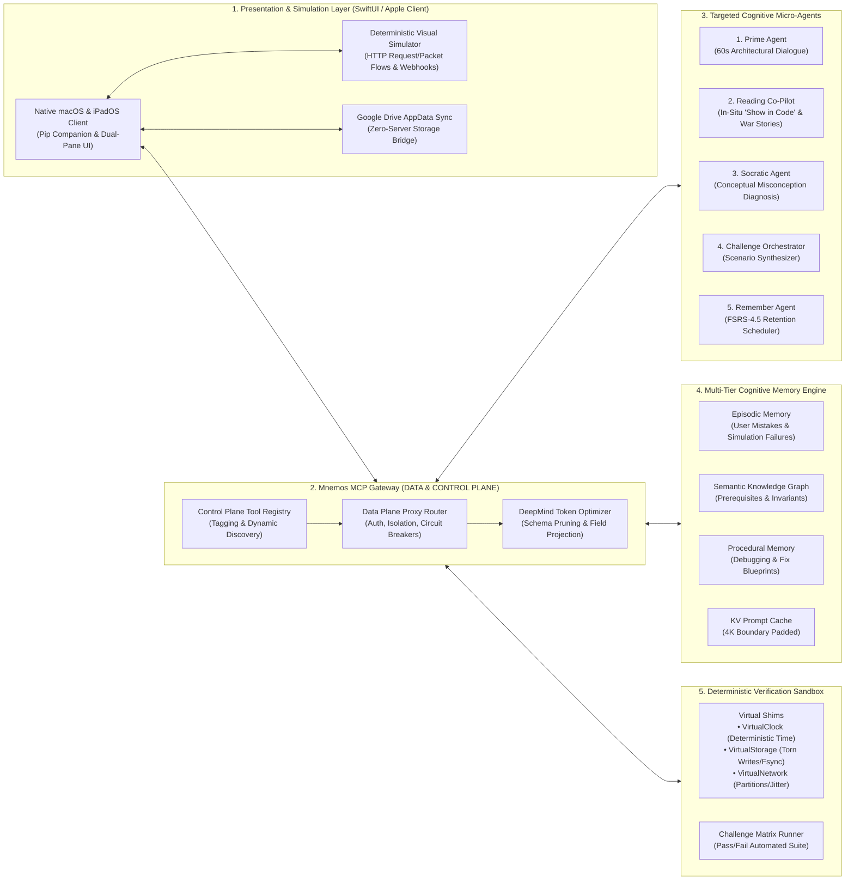
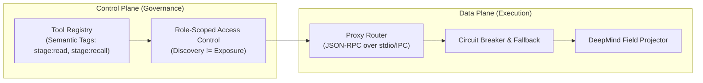
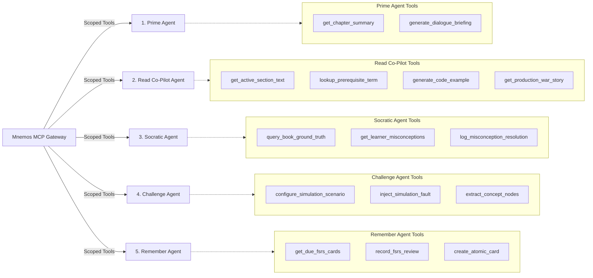
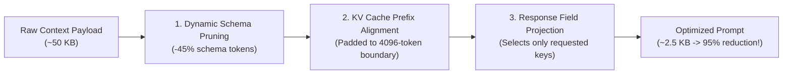
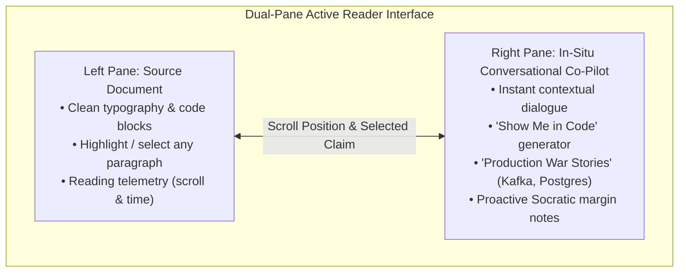
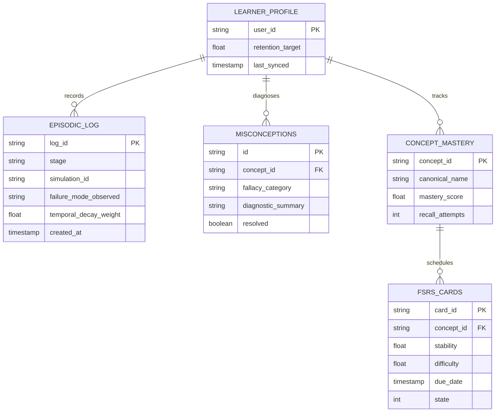
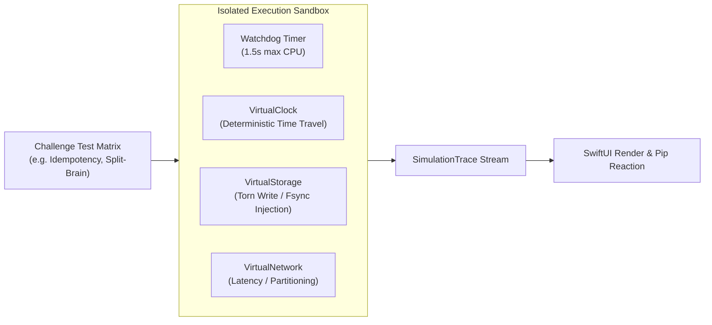

# Mnemos Architecture Specification
## The Hybrid Technical Mastery Platform: Deterministic Simulation & Targeted Micro-Agents
### Complete Technical Specification (HLD + LLD)

---

## 1. Architectural Overview & Design Motivation

Mnemos is an enterprise-grade learning platform for software engineers studying dense, critical systems topics (distributed systems, database internals, networking, concurrency, protocols).

It is built on a **Hybrid Architecture** that resolves the fundamental dilemma of AI learning platforms:

> [!IMPORTANT]
> **The Hybrid Core Principle**:
> 1. **Do NOT use LLMs for simulation**: Running HTTP packet flows, retry timers, or network partition states through an LLM is slow (1–3s latency), non-deterministic, expensive, and hallucination-prone. Instead, the **Interactive Visual Simulation Engine** is built as a **deterministic, 60 FPS client-side state machine** (SwiftUI / declarative FSM).
> 2. **Use AI Agents where semantic intelligence is unmatched**: Unstructured textbook digestion, Socratic misconception diagnosis, in-situ code explanation, and connecting theory to real production failure post-mortems (Stripe, GitHub, Netflix).
> 3. **Problem-Solving over Blind Coding**: Learners are not asked to write hundreds of lines of boilerplate code from scratch. Instead, they are presented with real architectural crises (e.g., duplicated webhook charges, network partition stalls, queue collapse). They inspect live HTTP requests, tweak system parameters (idempotency gates, retry policies, backoffs), and verify the fix visually.
> 4. **Zero Audio & Video Generation Overhead**: Dropped neural voice synthesis (`rumik`) and Chromium video rendering (`video.py`). Chapter preparation executes in **under 2 seconds**, making the pipeline 100% portable and instant.

---

## 2. High-Level Design (HLD): System Topology (Left-to-Right)



---

## 3. Low-Level Design (LLD): The Interactive Simulation Engine

### 3.1 Problem-Solving & Simulation Architecture
Instead of passive reading or manual coding, the platform runs interactive problem-solving simulations:

```
[Event Trigger] ──► [Signing & Dispatch] ──► [Network Simulation] ──► [Consumer Endpoint]
  (User Paid)        POST /webhook/payment      • Latency: 120ms          • Status: 500 Error!
                     Header: X-Signature        • Packet Loss: 15%        (Consumer Crashed)
                                                         │
                                                         ▼
                                                [RETRY DECISION ENGINE]
                                                Attempt 1: Fail ❌
                                                Backoff: 2s, 4s, 8s ⏱️
                                                Idempotency Check: ✅
                                                Attempt 2: 200 OK 🎉
```

1. **Visual Packet Inspection**: Clicking on an animated packet reveals full HTTP headers, payload, and HMAC signature:
   ```http
   POST /webhook/stripe-events HTTP/1.1
   Host: api.yourapp.com
   X-Mnemos-Signature: t=1711000000,v1=9a8b7c6d5e...
   Idempotency-Key: evt_99887766

   {"event": "payment_intent.succeeded", "amount": 4900}
   ```
2. **Fault Injection**: The learner injects realistic distributed systems chaos: packet drops, slow consumer responses, or duplicated requests.
3. **Problem Resolution**: The learner configures the architecture (adds an Idempotency Gate, adjusts exponential backoff parameters, or configures a Dead-Letter Queue). The deterministic simulation proves whether the problem is resolved.

---

## 4. Low-Level Design (LLD): The 5 AI Micro-Agents

Each agent has a strictly bounded, non-overlapping responsibility:

| Agent | Responsibility | Inputs | Outputs |
| :--- | :--- | :--- | :--- |
| **1. Prime Agent** | 60s Architectural Problem Framing | Chapter text from parser | 2-engineer dialogue (Theo & Ada) framing trade-offs and invariants. |
| **2. Reading Co-Pilot** | In-situ active reading co-pilot | Highlighted paragraph + query | • *"Show Me in Code"* (15-line runnable implementation)<br>• *"Production Reality Check"* (Stripe/AWS incident post-mortems). |
| **3. Socratic Agent** | Conceptual diagnostic evaluation | Free-text / verbal explanation | Misconception identification and a single targeted Socratic probing question. |
| **4. Challenge Orchestrator** | Scenario configuration synthesizer | Chapter invariants | Initial parameters for the deterministic visual simulation (failure rate, latency, payload). |
| **5. Remember Agent** | Long-term memory consolidation | Review performance + Episodic log | Mathematically optimal FSRS-4.5 spaced repetition review queue. |

---

## 5. Low-Level Design (LLD): The Uber MCP Gateway Engine

### 5.1 Control Plane vs. Data Plane Separation
Following Uber's design in [Designing MCP Gateway: Uber's MCP Management Platform](https://www.uber.com/us/en/blog/designing-mcp-gateway/):



### 5.2 Scoped Tools Matrix



---

## 6. Low-Level Design (LLD): Google DeepMind Token Optimization



1. **Dynamic Tool Schema Pruning:** By serving only the 2–3 tools needed for the active stage, we cut prompt overhead from 4,000 tokens to $<600$ tokens.
2. **Response Field Projection:** When an agent invokes `query_book_ground_truth`, the Gateway strips full markdown pages and returns only the top 3 verified sentence claims ($40\text{ KB} \rightarrow 1.2\text{ KB}$).
3. **KV Cache Prefix Alignment:** Pinned system instructions and book indexes enable model providers (Anthropic, Gemini, local vLLM) to reuse pre-computed attention keys and values, reducing streaming latency to $<400\text{ms}$.
4. **Semantic Context Compaction:** Compresses conversation histories into dense semantic vectors rather than raw transcripts.

---

## 7. Low-Level Design (LLD): Conversational Active Reading Co-Pilot (Stage 2)



### Developer Quick Actions:
* 💻 **"Show Me in Code":** Translates theoretical textbook text into a 15-line executable code snippet in Python, Go, TypeScript, or Rust.
* 🏭 **"Production Reality Check":** Explains where and how this theoretical concept is implemented in real-world systems (RocksDB, Kafka, Linux kernel) and where it fails in production.
* ⚖️ **"Devil's Advocate & Trade-Offs":** Interrogates the author's claims: *"What did the author sacrifice to achieve this? What happens under hardware faults or network partitions?"*
* 🧪 **"Spin Up Interactive Simulation":** Injects an interactive visual simulator directly beneath the paragraph.

---

## 8. Low-Level Design (LLD): Multi-Tier Cognitive Memory Engine



1. **Episodic Store**: Logs the student's past simulation failures, broken assertions, and conceptual misunderstandings with exponential time decay.
2. **Semantic Knowledge Graph**: Query API over `book_graph.py` concept dependencies (`get_prerequisites`, `get_downstream_dependents`).
3. **Procedural Memory**: Reusable systems engineering debugging blueprints and architectural templates.
4. **Vector Grounding**: Fast local embedding index for semantic lookup into exact textbook passages.

---

## 9. Low-Level Design (LLD): Verification Sandbox & Virtual Shims



- **`VirtualClock`**: Accelerates timeouts and election leases without `time.sleep()`.
- **`VirtualStorage`**: Injects simulated disk faults (uncommitted writes, partial flush).
- **`VirtualNetwork`**: Injects packet drops, symmetric and asymmetric partitions, and latency jitter.

---

## 10. Python Implementation Specification: `mcp_gateway.py`

```python
"""
Mnemos MCP Gateway Reference Implementation.
Implements Control Plane Tool Registry, Data Plane Proxy Router,
and DeepMind Dynamic Schema Pruning & Response Projection.
"""

from dataclasses import dataclass
from enum import Enum
from typing import Any, Callable, Coroutine
import logging

logger = logging.getLogger("mnemos.mcp_gateway")

class AgentRole(str, Enum):
    ORCHESTRATOR = "orchestrator"
    PRIME = "prime_agent"
    READ = "read_copilot"
    RECALL = "socratic_recall"
    CHALLENGE = "challenge_orchestrator"
    REMEMBER = "remember_agent"

@dataclass
class MCPToolDefinition:
    name: str
    description: str
    input_schema: dict[str, Any]
    allowed_roles: set[AgentRole]
    handler: Callable[..., Coroutine[Any, Any, dict[str, Any]]]
    enabled: bool = True
    projection_fields: list[str] | None = None

class MCPGateway:
    """Central MCP Gateway handling Tool Discovery, Scoped Access, and Protocol Routing."""

    def __init__(self):
        self._registry: dict[str, MCPToolDefinition] = {}

    def register_tool(
        self,
        name: str,
        description: str,
        input_schema: dict[str, Any],
        allowed_roles: set[AgentRole],
        handler: Callable[..., Coroutine[Any, Any, dict[str, Any]]],
        projection_fields: list[str] | None = None,
    ):
        """Register a backend service tool into the Control Plane Registry."""
        self._registry[name] = MCPToolDefinition(
            name=name,
            description=description,
            input_schema=input_schema,
            allowed_roles=allowed_roles,
            handler=handler,
            enabled=True,
            projection_fields=projection_fields,
        )

    def get_scoped_tools(self, role: AgentRole) -> list[dict[str, Any]]:
        """DeepMind-style Dynamic Schema Pruning: Returns ONLY tools for the active role."""
        return [
            {
                "name": tool.name,
                "description": tool.description,
                "input_schema": tool.input_schema,
            }
            for tool in self._registry.values()
            if tool.enabled and role in tool.allowed_roles
        ]

    async def invoke_tool(
        self,
        caller_role: AgentRole,
        tool_name: str,
        arguments: dict[str, Any],
        projection: list[str] | None = None,
    ) -> dict[str, Any]:
        """Data Plane Execution Router with Role Scoping & Response Projection."""
        tool = self._registry.get(tool_name)
        if not tool or not tool.enabled:
            raise ValueError(f"Tool '{tool_name}' not found or disabled.")

        if caller_role not in tool.allowed_roles:
            raise PermissionError(f"Agent '{caller_role.value}' unauthorized for '{tool_name}'.")

        try:
            raw_output = await tool.handler(**arguments)
        except Exception as e:
            logger.exception(f"Tool execution failed: {e}")
            return {"error": str(e), "status": "failed"}

        # DeepMind Response Projection: Project only requested fields
        fields_to_project = projection or tool.projection_fields
        if fields_to_project and isinstance(raw_output, dict):
            projected = {k: raw_output[k] for k in fields_to_project if k in raw_output}
            return {"status": "success", "data": projected}

        return {"status": "success", "data": raw_output}
```
