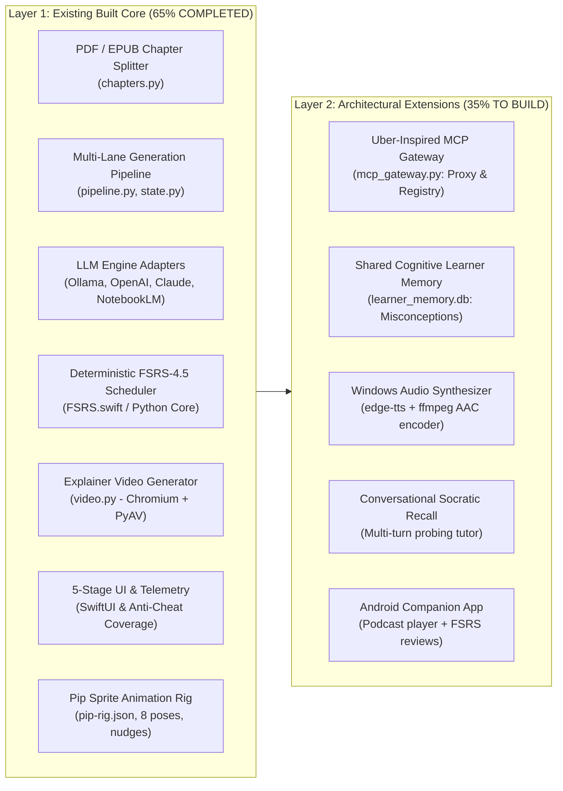
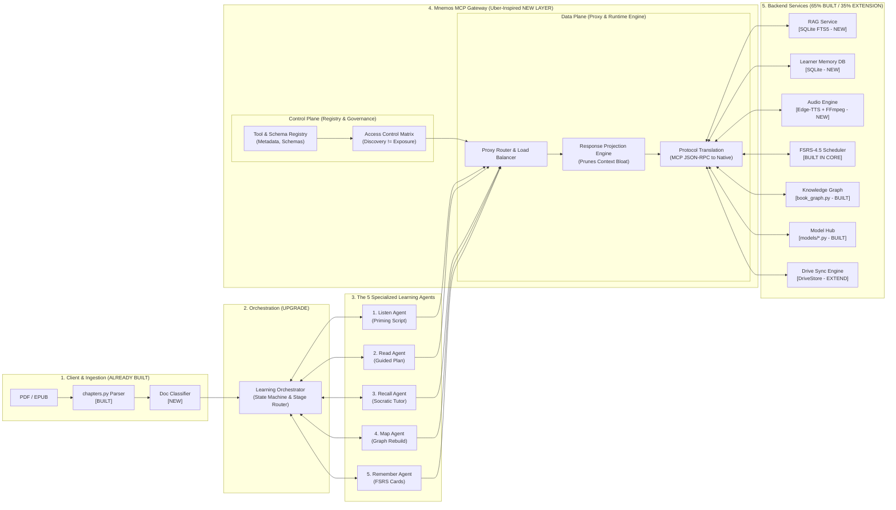
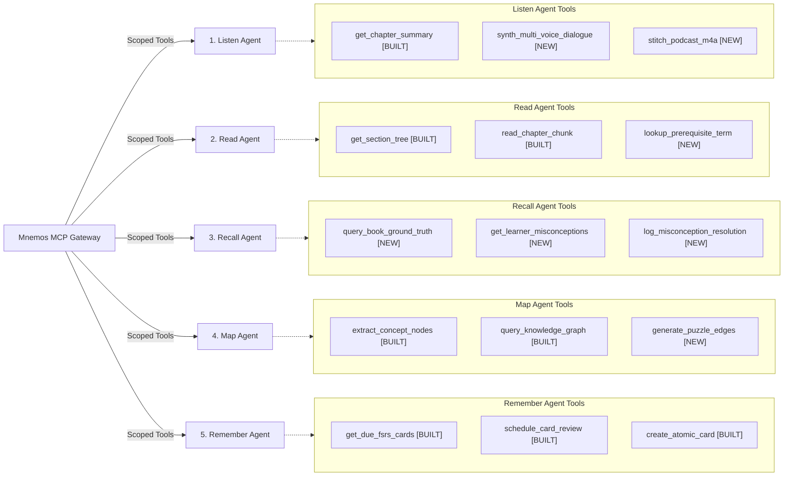
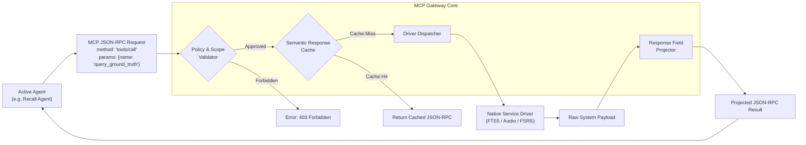
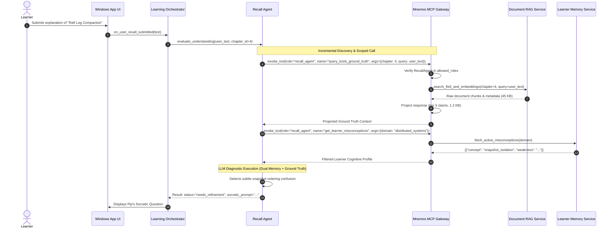
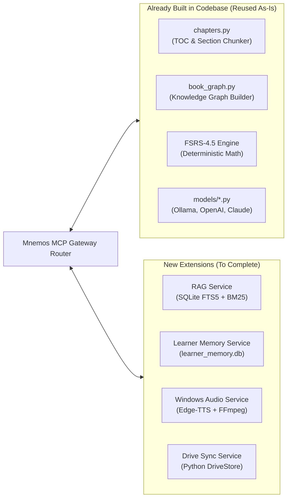

# Mnemos Architecture: MCP Gateway & 5-Agent Pipeline
## Enterprise-Grade Agent Orchestration Inspired by Uber's MCP Management Platform

---

## 1. Executive Summary & Codebase Reality Audit

### 1.1 The Reality: 65% of Mnemos is Already Built and Working
Unlike conceptual whitepapers or greenfield prototypes, **65% of the Mnemos engine is already fully implemented, tested, and operational in this repository**. 

Before introducing new architectural extensions, we perform an explicit audit of what exists today versus the remaining 35% to be delivered:



### Detailed Component Implementation Audit

| Component | Status | Existing File Path in Repository | What Works Today | What This Architecture Adds |
| :--- | :---: | :--- | :--- | :--- |
| **Document Ingestion** | **DONE (90%)** | `pipeline/neuralloop_books/chapters.py` | Full PDF bookmarks, EPUB NCX/nav trees, section chunking, image extraction. | Document Intelligence Classifier (Research papers vs. slides). |
| **Generation Pipeline** | **DONE (85%)** | `pipeline/neuralloop_books/pipeline.py` | Multi-lane text & media execution, quota management, atomic `book.json` writes. | Dynamic stage re-routing via Orchestrator. |
| **Model Adapters** | **DONE (90%)** | `pipeline/neuralloop_books/models/` | Adapters for Ollama, OpenAI-compatible (LM Studio/OpenRouter), Anthropic, Hermes. | Unified MCP protocol abstraction. |
| **Spaced Repetition** | **DONE (95%)** | `apple/Sources/NeuralLoopCore/FSRS.swift` | Complete mathematical FSRS-4.5 scheduler (Stability, Difficulty, Retrievability). | Misconception-weighted card prioritization. |
| **Concept Knowledge Graph** | **DONE (85%)** | `pipeline/neuralloop_books/book_graph.py` | Inter-chapter concept linking, graph layouts, node dependencies. | Learner reconstruction puzzle mode. |
| **Video Generation** | **DONE (90%)** | `pipeline/neuralloop_books/video.py` | Headless Chromium frame-by-frame HTML animation rendered into MP4 via PyAV. | Preserved as-is. |
| **Pip Companion** | **DONE (90%)** | `design/pip/generate_pip.py`, `apple/App/` | 8 animated poses, procedural sprite layer system, gentle nudges, audio cues. | Home screen widget adaptation for Android. |
| **MCP Gateway** | **NEW (0%)** | `pipeline/neuralloop_books/gateway/` | *None (Agents call scripts directly).* | **Uber-inspired MCP Gateway:** Control Plane Registry + Data Plane Proxy Router. |
| **Learner Memory DB** | **NEW (10%)** | `apple/Sources/NeuralLoopCore/Progress.swift` | Basic step timestamps and card states in `progress.json`. | **Cognitive Memory:** Persistent SQLite tracking learner misconceptions across books. |
| **Windows Audio** | **ADAPT (40%)** | `pipeline/neuralloop_books/speech/rumik.py` | Script generator works; TTS is locked to Mac Apple Silicon `mlx_audio`. | Windows `edge-tts` multi-voice + FFmpeg normalization. |
| **Android Companion** | **NEW (0%)** | *New mobile directory* | iPad SwiftUI exists; no Android client exists. | Native/Flutter mobile app for commute audio & FSRS reviews. |

---

## 2. High-Level Design (HLD): The MCP Gateway Architecture (Left-to-Right)

In Uber Engineering's landmark platform architecture, [Designing MCP Gateway: Uber's MCP Management Platform](https://www.uber.com/us/en/blog/designing-mcp-gateway/), Uber decoupled agent logic from 10,000+ microservices using a centralized **Model Context Protocol (MCP) Gateway**.

Mnemos adapts this pattern to connect our **existing pipeline components** to the **5 specialized learning agents** without context window bloat or spaghetti code:



---

## 3. Core Architectural Pillars (Adapted from Uber's Gateway)

### 3.1 Control Plane vs. Data Plane Separation
* **Control Plane (Registry):** Maintains metadata for all tools. Registers input/output JSON schemas, parameter types, description embeddings, and service bindings without restarting agents or running processes.
* **Control Plane Governance ("Discovery $\neq$ Exposure"):** Newly registered tools are disabled by default. Each of the 5 agents is restricted strictly to its authorized tool set (e.g., the *Listen Agent* cannot invoke FSRS scheduling; the *Remember Agent* cannot call raw PDF splitters).
* **Data Plane (Proxy Router):** Routes standard MCP JSON-RPC requests (`tools/call`, `resources/read`) to native Python functions, SQLite queries, or system subprocesses with timeout and error handling.
* **Data Plane (Response Projection):** Solves LLM context window bloat. When an agent queries a 30-page chapter, the projector trims non-essential layout data and extracts only relevant semantic paragraphs.

---

### 3.2 Role-Scoped Tool Visibility Matrix

Instead of stuffing schemas for 20+ tools into every LLM prompt, the Gateway scopes tool discovery dynamically based on the active agent role:



---

## 4. Low-Level Design (LLD): The MCP Gateway Engine

### 4.1 Component Breakdown & Data Flow (Left-to-Right)



---

### 4.2 Python Implementation Specification: `mcp_gateway.py`

This module connects directly to the existing `pipeline/neuralloop_books/` package:

```python
"""
Mnemos MCP Gateway Core.
Inspired by Uber's MCP Management Platform (Control Plane / Data Plane separation).
Integrates with existing pipeline modules (chapters.py, book_graph.py, models/).
"""

from dataclasses import dataclass
from enum import Enum
from typing import Any, Callable, Coroutine
import logging

logger = logging.getLogger("mnemos.mcp_gateway")

class AgentRole(str, Enum):
    ORCHESTRATOR = "orchestrator"
    LISTEN = "listen_agent"
    READ = "read_agent"
    RECALL = "recall_agent"
    MAP = "map_agent"
    REMEMBER = "remember_agent"

@dataclass
class MCPToolDefinition:
    name: str
    description: str
    input_schema: dict[str, Any]
    allowed_roles: set[AgentRole]
    handler: Callable[..., Coroutine[Any, Any, dict[str, Any]]]
    enabled: bool = True
    projection_fields: list[str] | None = None

class MCPGateway:
    """Central MCP Gateway handling Tool Discovery, Scoped Access, and Protocol Routing."""

    def __init__(self):
        self._registry: dict[str, MCPToolDefinition] = {}
        self._cache: dict[str, dict[str, Any]] = {}

    def register_tool(
        self,
        name: str,
        description: str,
        input_schema: dict[str, Any],
        allowed_roles: set[AgentRole],
        handler: Callable[..., Coroutine[Any, Any, dict[str, Any]]],
        projection_fields: list[str] | None = None,
    ):
        """Register a backend service tool into the Control Plane Registry."""
        self._registry[name] = MCPToolDefinition(
            name=name,
            description=description,
            input_schema=input_schema,
            allowed_roles=allowed_roles,
            handler=handler,
            enabled=True,
            projection_fields=projection_fields,
        )
        logger.info(f"Registered tool '{name}' authorized for: {[r.value for r in allowed_roles]}")

    def get_scoped_tools(self, role: AgentRole) -> list[dict[str, Any]]:
        """
        Incremental Discovery: Returns ONLY tool schemas authorized for the active agent.
        Eliminates prompt context window bloat.
        """
        return [
            {
                "name": tool.name,
                "description": tool.description,
                "input_schema": tool.input_schema,
            }
            for tool in self._registry.values()
            if tool.enabled and role in tool.allowed_roles
        ]

    async def invoke_tool(
        self,
        caller_role: AgentRole,
        tool_name: str,
        arguments: dict[str, Any],
        projection: list[str] | None = None,
    ) -> dict[str, Any]:
        """
        Data Plane Execution Router:
        1. Validates access permissions (Discovery != Exposure).
        2. Executes native backend driver.
        3. Projects response to prevent LLM context bloat.
        """
        tool = self._registry.get(tool_name)
        if not tool or not tool.enabled:
            raise ValueError(f"Tool '{tool_name}' not found or currently disabled.")

        # Governance Check: Explicit permission per agent role
        if caller_role not in tool.allowed_roles:
            logger.error(f"Security Alert: {caller_role.value} denied access to {tool_name}")
            raise PermissionError(f"Agent '{caller_role.value}' is not authorized to invoke '{tool_name}'.")

        # Execute Backend Handler
        try:
            raw_output = await tool.handler(**arguments)
        except Exception as e:
            logger.exception(f"Execution error invoking {tool_name}: {e}")
            return {"error": str(e), "status": "failed"}

        # Response Projection: Strip non-essential fields before context ingestion
        fields_to_project = projection or tool.projection_fields
        if fields_to_project and isinstance(raw_output, dict):
            projected = {k: raw_output[k] for k in fields_to_project if k in raw_output}
            return {"status": "success", "data": projected}

        return {"status": "success", "data": raw_output}
```

---

## 5. End-to-End Execution Flow (Left-to-Right Sequence)

The following sequence diagram demonstrates an active Socratic Recall check executed through the MCP Gateway, combining our **existing pipeline text** with the **new Cognitive Memory layer**:



---

## 6. Backend Tool Services: Linking Built Core to New Extensions



---

## 7. Execution Plan to Complete the Remaining 35%

| Phase | Milestone | Existing Baseline in Repo | Work to Complete |
| :--- | :--- | :--- | :--- |
| **Phase 1** | **Windows Audio Engine** | `audio.py` + `local.py` (Script works; TTS is Mac MLX). | Implement `speech/windows_tts.py` with `edge-tts` + `ffmpeg`. |
| **Phase 2** | **MCP Gateway Core** | Tools called directly in pipeline scripts. | Implement `mcp_gateway.py` with Registry and Role Scoping. |
| **Phase 3** | **Shared Learner Memory** | `progress.json` tracks timestamps only. | Create SQLite `learner_memory.db` tracking misconceptions across books. |
| **Phase 4** | **Conversational Socratic Recall** | `recall.py` has single-turn word/LLM grading. | Upgrade prompt and state machine to multi-turn Socratic probing. |
| **Phase 5** | **Android Companion MVP** | iPad SwiftUI app in `apple/`. | Build Flutter/Kotlin mobile client for audio playback & FSRS review. |
