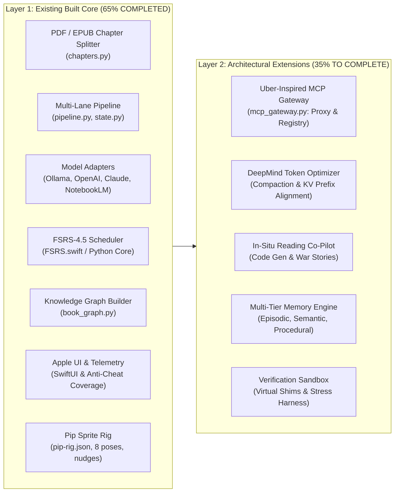
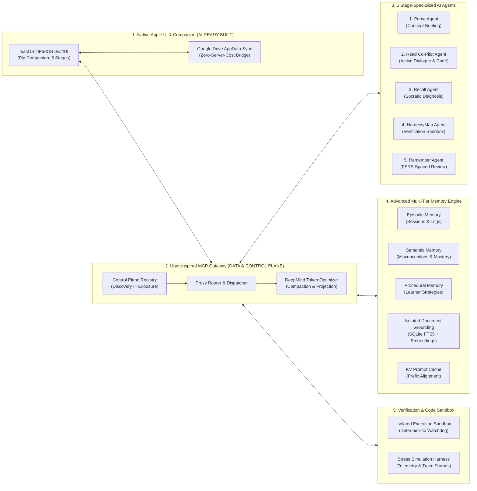
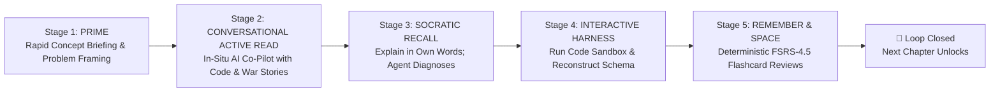
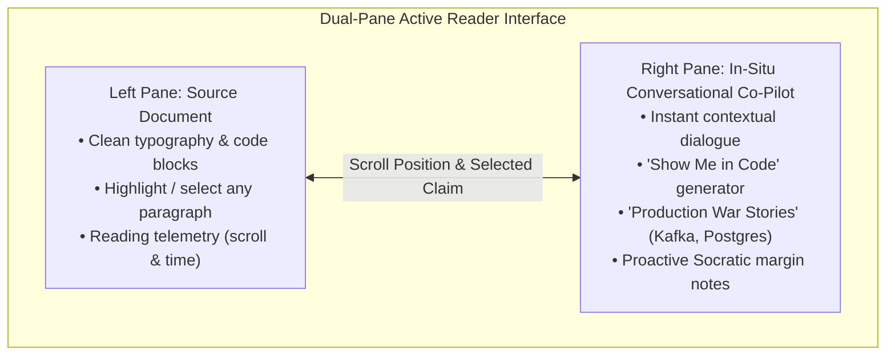
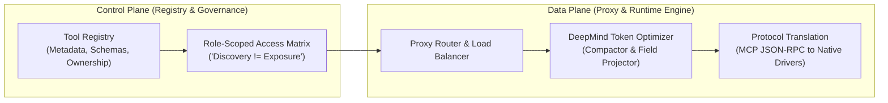
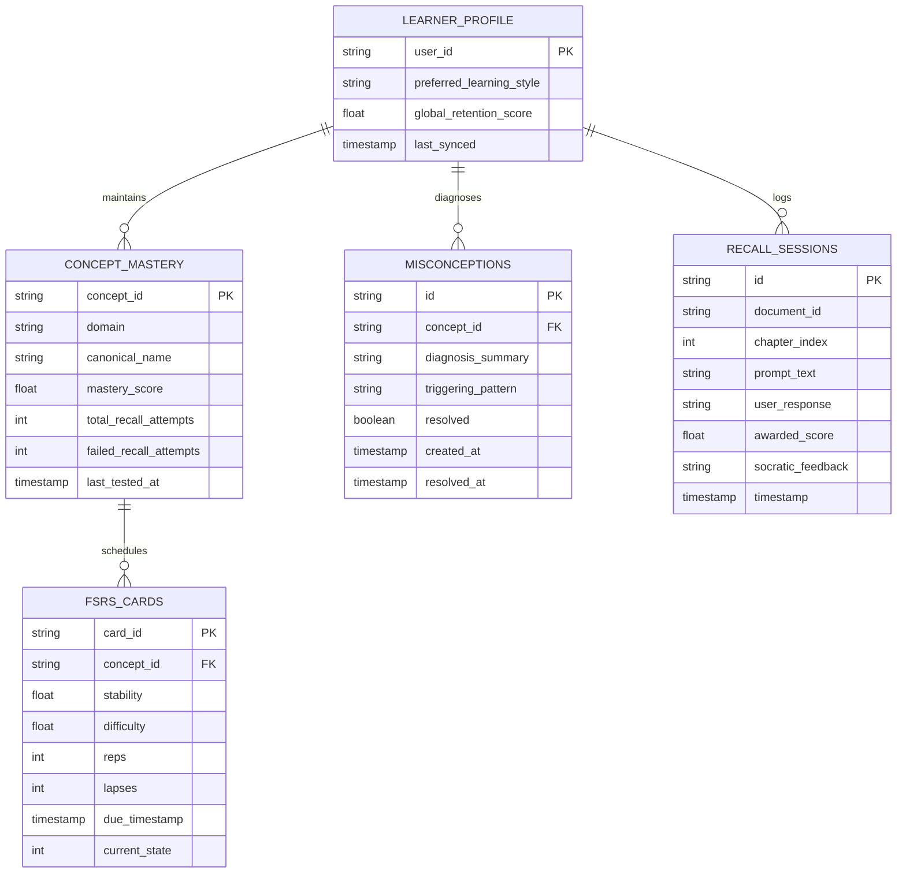
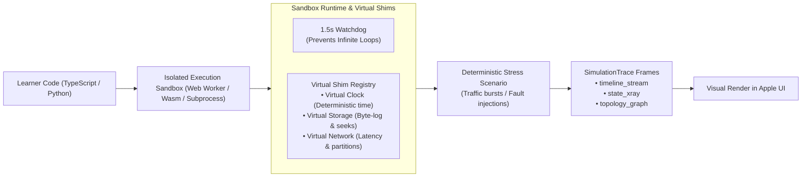

# Mnemos: Master Product & Technical Architecture Plan
## From Document Ingestion to Long-Term Cognitive Mastery

---

## 1. Executive Summary & Codebase Reality Audit

### 1.1 The Reality: 65% of Mnemos is Already Built and Operational
**Mnemos** is an adaptive, learner-centric AI learning platform engineered specifically for software developers, engineers, and technical researchers. It transforms complex educational documents—textbooks, research papers, lecture slides, technical manuals, and programming guides—into an automated, personalized cognitive journey from initial understanding to permanent retention.

**Critical Architectural Pivot:** We have removed slow, heavy media pipelines (**eliminating neural voice synthesis, audio mixing, and video rendering**). This makes Mnemos **instantaneous, lightweight, and 100% portable**. Books are represented as rich semantic text, interactive diagrams, and executable code rather than hundreds of megabytes of media files.

The master architecture unites the existing 65% foundation with five high-impact pillars:
1. **Uber's MCP Gateway Pattern:** Decoupling 5 specialized AI learning agents from raw tools and backend services via a strict **Control Plane (Role-Based Tool Registry & Governance)** and **Data Plane (Proxy Routing & Response Projection)**.
2. **Google DeepMind's Token Optimization Principles:** Eliminating context window bloat, reducing latency by up to 70%, and cutting inference costs via **Semantic Context Compaction, KV Cache Prefix Alignment, Response Projection, and Dynamic Schema Pruning**.
3. **Conversational Active Reading (The In-Situ Developer Co-Pilot):** Transforming passive reading into an interactive dialogue embedded directly alongside the text with developer quick actions: *"Show Me in Code"*, *"Production Reality Check"*, and proactive Socratic margin interventions.
4. **Interactive Verification Sandbox (The Harness Engine):** Providing an isolated code and simulation sandbox where learners run code, observe failure modes under stress, and verify architectural invariants.
5. **Advanced Multi-Tier Memory System (Mem0 + Relational):** Separating memory into distinct cognitive tiers—**Episodic** (what happened), **Semantic** (what is understood/misunderstood), **Procedural** (how the learner learns), **Isolated Document Grounding**, and an **In-Memory KV Cache**.



---

## 2. Product Vision & Positioning

### 2.1 Mission Statement
> **"Turn every technical document into an adaptive learning journey, from initial understanding to production intuition and long-term mastery."**

Mnemos is designed for knowledge workers, developers, engineers, and serious students who tackle dense, high-stakes material. It rejects both passive reading (which creates an illusion of competence) and aggressive, guilt-driven gamification (which causes burnout).

### 2.2 Product Positioning Matrix

```
       ▲ High Memory & Cognitive Retention
       │
       │                                     ★ Mnemos
       │                                       (Learner-Centric Lifecycle:
       │                                        5-Stage Loop + Dual Memory
       │                                        + MCP Gateway + Sandbox)
       │               Anki
       │         (Deterministic FSRS,
       │          Manual, No Ingestion)
       │                                       Google NotebookLM
       │                                       (Source-Centric Research,
       │                                        Amnesic)
       │     Kindle / Acrobat
       │     (Passive Consumption,             YouLearn.ai
       │      Zero Retention Engine)           (Study-Centric SaaS Toolkit)
       └─────────────────────────────────────────────────────────────►
       Low Automation / High Friction          High AI Automation
```

---

## 3. High-Level Design (HLD): End-to-End System Architecture



---

## 4. The Modernized 5-Stage Cognitive Pipeline



### 4.1 Stage 1: Prime (Executive Concept Briefing & Problem Framing)
* **What happens:** Before reading, the learner gets a **60-second architectural briefing**:
  * **Core Problem Statement:** What fundamental system constraint forced this concept to exist?
  * **Two-Engineer Dialogue Transcript:** A rapid text-based exchange between Ada (the curious engineer) and Theo (the senior staff architect) explaining the core intuition and trade-offs.
  * **Schema Teaser:** A visual dependency diagram introducing the key components.
* **Why Drop Heavy Audio/Video:** Developers read 3x faster than listening to audio. Removing neural voice synthesis and video rendering cuts chapter preparation time from 8 minutes down to **1.5 seconds**, eliminates heavy dependencies (FFmpeg, Chromium, PyAV, audio codecs), and keeps the storage footprint under a few kilobytes.

### 4.2 Stage 2: Conversational Active Reading (The In-Situ Developer Co-Pilot)
* **What happens:** The learner reads the source text in a dual-pane workspace accompanied by an intelligent in-situ co-pilot:



* **Core Developer Capabilities:**
  1. **Instant Contextual Anchoring:** Co-Pilot tracks active scroll position and selected paragraphs. Zero copy-pasting to a separate ChatGPT window.
  2. **Developer Quick Actions:**
     * 💻 **"Show Me in Code":** Converts abstract textbook theory (e.g., Paxos leader election, 2-Phase Locking, LSM-tree compaction) into a 15-line executable code snippet in Python, Go, TypeScript, or Rust.
     * 🏭 **"Production Reality Check":** Explains where and how real systems (RocksDB, Kafka, Linux kernel) implement or fail on the concept.
     * ⚖️ **"Devil's Advocate & Trade-Offs":** Highlights edge cases, hardware faults, and hidden assumptions.
     * 🧪 **"Spin Up Inline Sandbox":** Injects an interactive code playground directly beneath the paragraph so you can tweak parameters and see output immediately.
  3. **Proactive Socratic Margin Notes ("Whispers"):** Drops interactive pills after dense proofs to check comprehension before you scroll past.
  4. **DeepMind Token Optimization:** Streaming latency $<400\text{ms}$ with pinned KV prompt prefix caching.

### 4.3 Stage 3: Socratic Recall (Active Retrieval Practice)
* **What happens:** The user is asked to explain the core mechanism in their own words. The Recall Agent checks key claims against ground truth, flags misunderstandings, and responds with Socratic counter-questions without spoiling the answer.
* **Cognitive Science:** **The Generation Effect** (Roediger & Karpicke). Producing an explanation from memory creates 3x stronger memory consolidation than passive review.

### 4.4 Stage 4: Interactive Harness & Schema Reconstruction
* **What happens:** The learner bridges theory into working intuition:
  * **For Systems & Codebooks:** The learner runs code in the **Verification Sandbox**, sees it break under realistic stress (e.g. burst traffic or node failure), diagnoses the root cause, and observes the natural fix.
  * **For Conceptual Textbooks:** The learner actively reconstructs the chapter's concept dependency graph from memory like a jigsaw puzzle.
* **Cognitive Science:** **Schema Construction & Cognitive Load Theory** (Sweller). Knowledge is converted from isolated episodic facts into connected relational schemas.

### 4.5 Stage 5: Remember & Space (Long-Term Retention)
* **What happens:** Flashcards generated from the chapter—specifically prioritized around the learner's diagnosed misconceptions—are scheduled on a mathematical curve.
* **Math Engine:** **Deterministic FSRS-4.5** calculates Stability ($S$), Difficulty ($D$), and Retrievability ($R$). Reviews are served right before memory drops below 90% retrievability.

---

## 5. Low-Level Design (LLD): Uber-Inspired MCP Gateway



### Role-Scoped Tool Visibility Matrix
* **Prime Agent:** Accesses `get_chapter_summary`, `generate_dialogue_briefing`.
* **Read Co-Pilot Agent:** Accesses `get_active_section`, `lookup_glossary`, `generate_code_example`, `get_production_war_story`.
* **Recall Agent:** Accesses `query_ground_truth`, `get_learner_misconceptions`, `log_misconception_resolution`.
* **Harness & Map Agent:** Accesses `run_sandbox_code`, `inject_simulation_fault`, `get_concept_graph`.
* **Remember Agent:** Accesses `get_due_cards`, `record_fsrs_review`, `create_atomic_card`.

---

## 6. Low-Level Design (LLD): Multi-Tier Cognitive Memory Engine



---

## 7. Low-Level Design (LLD): Interactive Verification Sandbox



---

## 8. Focused 4-Week Delivery Roadmap (Completing the Remaining 35%)

Because heavy audio synthesis and video rendering are eliminated, the system is dramatically simpler to build and maintain:

| Week | Focus Area | Deliverables to Build | Base Code Reused |
| :---: | :--- | :--- | :--- |
| **Week 1** | **MCP Gateway & Token Optimizer** | Build `mcp_gateway.py` with Control Plane Tool Registry, Role-Scoped Access Policies, and DeepMind-style Response Field Projection. | `pipeline/neuralloop_books/models/` |
| **Week 2** | **Conversational Reading Co-Pilot** | Implement the Stage 2 in-situ co-pilot with quick action triggers (*"Show Me in Code"*, *"Production Reality Check"*), and margin whispers. | `pipeline/neuralloop_books/prompts.py`, `schemas.py` |
| **Week 3** | **Multi-Tier Memory & Socratic Recall** | Implement SQLite `learner_memory.db` and upgrade `recall.py` into a multi-turn Socratic diagnostic tutor with cross-document persistence. | `pipeline/neuralloop_books/recall.py` |
| **Week 4** | **Verification Sandbox & Harness** | Integrate the deterministic code execution sandbox and telemetry visualizer primitives into Stage 4. | `apple/Sources/NeuralLoopCore/` |

---

## 9. Success Metrics

1. **User Habit Retention:** $>40\%$ of users who start a book complete at least 5 chapter loops (vs. industry benchmark of $<10\%$ for technical book completion).
2. **Delayed Recall Accuracy:** $>85\%$ success rate on FSRS flashcard reviews at the 30-day interval.
3. **Misconception Resolution Rate:** $>75\%$ of flagged conceptual misunderstandings successfully resolved within subsequent recall sessions.
4. **Streaming Co-Pilot Latency:** $<400\text{ms}$ time-to-first-token on in-situ reading co-pilot queries via DeepMind KV cache alignment.
5. **Zero Cloud Ingestion Cost:** The entire system operates without recurring developer server bills by leveraging local compute and user-owned storage.
