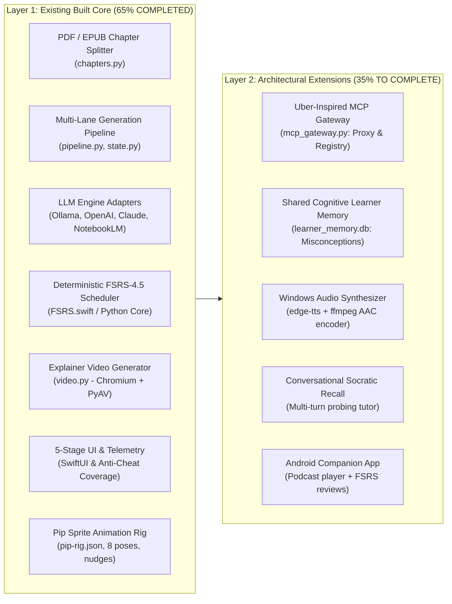
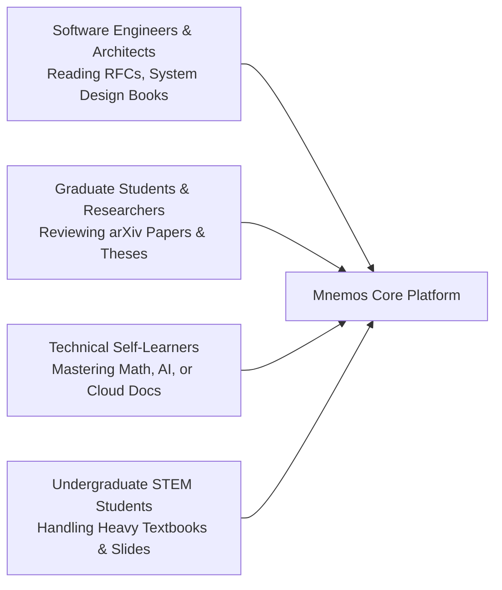
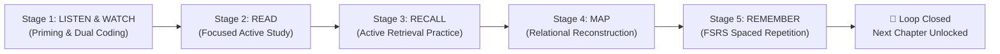
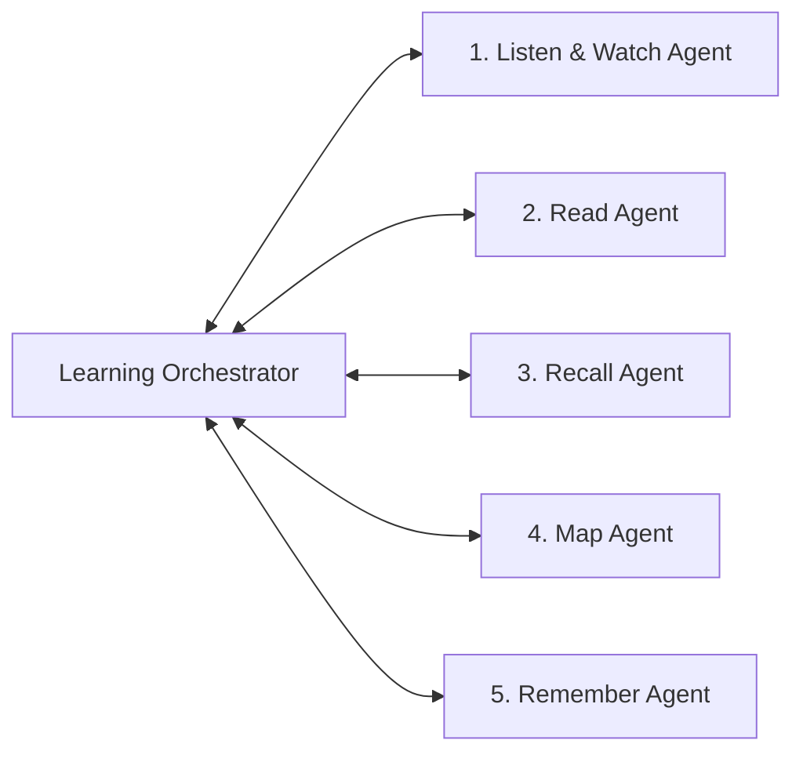
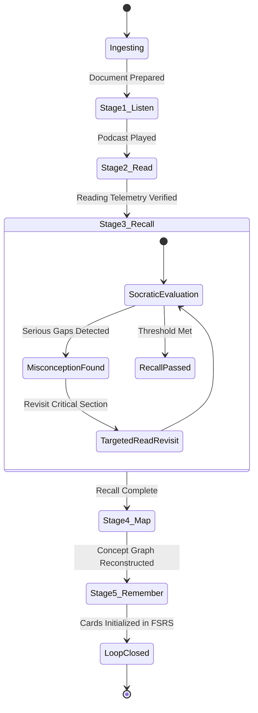
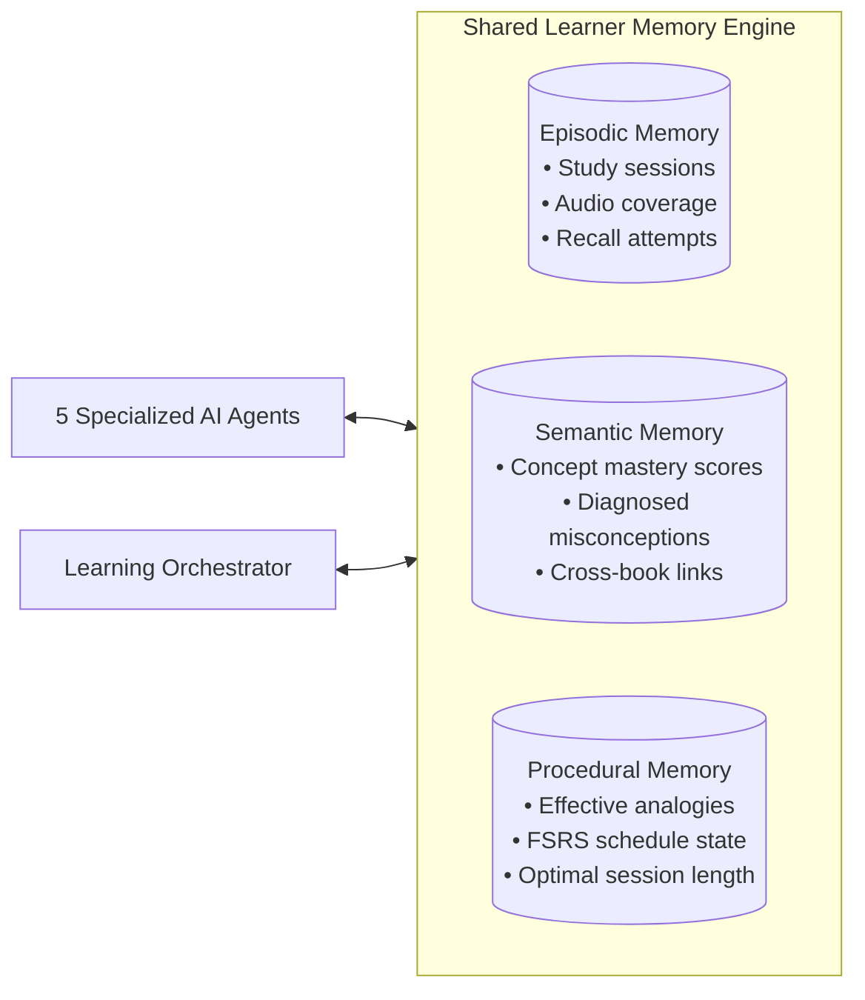
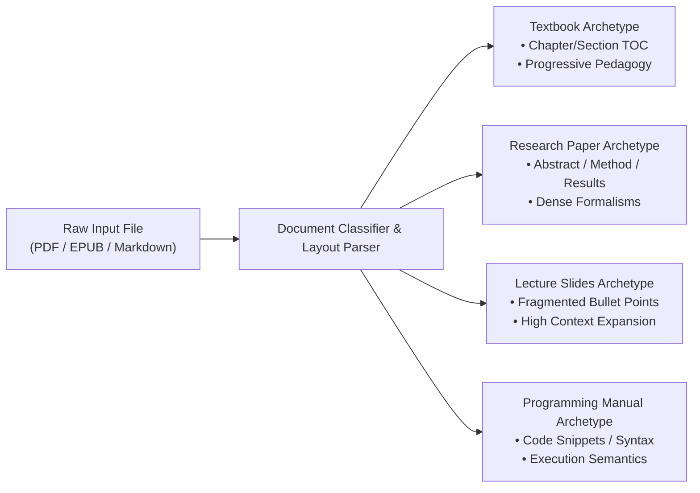
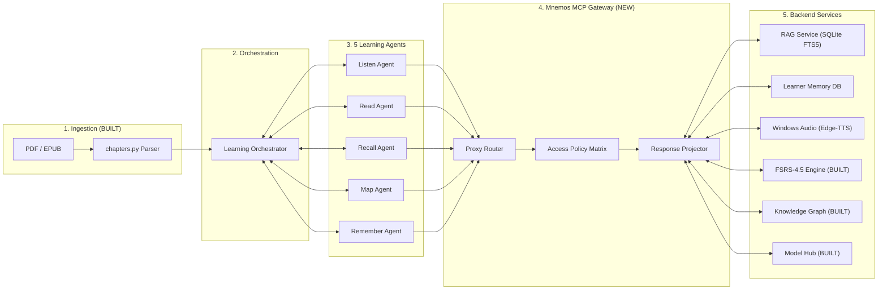

# Mnemos: Master Product & Technical Architecture Plan
## From Document Ingestion to Long-Term Cognitive Mastery

---

## 1. Executive Summary & Codebase Reality Audit

### 1.1 The Reality: 65% of Mnemos is Already Built and Operational
**Mnemos** is an adaptive, learner-centric AI learning platform. It transforms complex educational documents—textbooks, research papers, lecture slides, technical manuals, and programming guides—into an automated, personalized cognitive journey from initial understanding to permanent retention.

**Critical Project Context:** This project does not start from zero. **Approximately 60% to 70% of the core architecture is already fully implemented, tested, and operational in this codebase** (including the multi-lane book pipeline, EPUB/PDF TOC parsing, model adapters, deterministic FSRS-4.5 engine, explainer video generator, and procedural Pip sprite rig).

The goal of this master plan is to preserve and leverage that proven 65% foundation, while integrating the remaining 35% architectural breakthroughs:
1. **The MCP Gateway Layer (Uber-Inspired):** Decoupling the 5 learning agents from raw backend services to eliminate context bloat and enforce role-based tool security.
2. **The Shared Cognitive Learner Memory:** Moving beyond stateless sessions by tracking student misconceptions and concept mastery curves *persistently across books*.
3. **Cross-Platform Delivery (Windows Desktop + Android Companion):** Porting the speech and sync engines to run natively on Windows (via `edge-tts` and FFmpeg) and synchronizing to mobile via private Google Drive `appDataFolder`.



---

## 2. Product Vision & Positioning

### 2.1 Mission Statement
> **"Turn every document into an adaptive learning journey, from initial understanding to long-term mastery."**

Mnemos is designed for knowledge workers, developers, engineers, and serious students who tackle dense, high-stakes material. It rejects both passive reading (which creates an illusion of competence) and aggressive, guilt-driven gamification (which causes burnout).

### 2.2 Product Positioning Matrix

```
       ▲ High Memory & Cognitive Retention
       │
       │                                     ★ Mnemos
       │                                       (Learner-Centric Lifecycle:
       │                                        5-Stage Loop + Dual Memory)
       │               Anki
       │         (Deterministic FSRS,
       │          Manual, No Ingestion)
       │                                       Google NotebookLM
       │                                       (Source-Centric Research,
       │                                        Audio Overviews, Amnesic)
       │     Kindle / Acrobat
       │     (Passive Consumption,             YouLearn.ai
       │      Zero Retention Engine)           (Study-Centric SaaS Toolkit)
       └─────────────────────────────────────────────────────────────►
       Low Automation / High Friction          High AI Automation
```

---

## 3. Codebase Audit: Built Foundation (65%) vs. Target Extensions (35%)

To remain strictly grounded in reality, we distinguish what exists in the repository today from what this plan specifies:

| System Area | State in Repository Today (65% Built) | Remaining Work to Complete (35%) | Existing File Path in Repo |
| :--- | :--- | :--- | :--- |
| **Document Ingestion** | **90% Complete:** Robust PDF bookmarks & EPUB NCX parser, section chunking, image extraction, zip bomb safety limits. | Add document classifier (Research paper vs. lecture slides vs. textbook). | `pipeline/neuralloop_books/chapters.py` |
| **Generation Pipeline** | **85% Complete:** Multi-lane parallel execution (text lane vs. media lane), quota management, atomic `book.json` writes. | Integrate with Learning Orchestrator for dynamic stage skipping and re-routing. | `pipeline/neuralloop_books/pipeline.py` |
| **Model Adapters** | **90% Complete:** Tested adapters for Ollama, OpenAI-compatible (LM Studio/OpenRouter), Anthropic, OpenCode, Hermes. | Wrap behind standardized MCP tool interfaces. | `pipeline/neuralloop_books/models/` |
| **Spaced Repetition** | **95% Complete:** Fully implemented, verified mathematical FSRS-4.5 engine (Stability, Difficulty, Retrievability). | Misconception-weighted review prioritization. | `apple/Sources/NeuralLoopCore/FSRS.swift` |
| **Concept Knowledge Graph** | **85% Complete:** Inter-chapter concept linking, graph layouts, node dependencies, JSON schema export. | Add active learner reconstruction puzzle mode. | `pipeline/neuralloop_books/book_graph.py` |
| **Explainer Video Engine** | **90% Complete:** Headless Chromium frame-by-frame HTML animation rendered into MP4 via PyAV. | Preserved as-is. | `pipeline/neuralloop_books/video.py` |
| **Pip Sprite Companion** | **90% Complete:** 8 animated poses, procedural sprite layer system, gentle nudges, audio cues. | Home screen widget adaptation for Android. | `design/pip/generate_pip.py`, `apple/App/` |
| **MCP Gateway** | **0% Complete:** *None (Agents call scripts directly).* | **Build Uber-inspired MCP Gateway:** Control Plane Registry + Data Plane Proxy Router. | `pipeline/neuralloop_books/gateway/` |
| **Learner Memory DB** | **10% Complete:** `progress.json` tracks step completion timestamps and card states only. | **Build Cognitive Memory:** Persistent SQLite tracking learner misconceptions across books. | `pipeline/neuralloop_books/memory/` |
| **Windows Audio** | **40% Complete:** Script generation works; voice synthesis is locked to Mac Apple Silicon `mlx_audio` & `afconvert`. | Implement Windows `edge-tts` multi-voice synthesis + FFmpeg normalization. | `pipeline/neuralloop_books/speech/` |
| **Android Companion** | **0% Complete:** iPad SwiftUI app exists; no Android client exists. | Build Flutter/Kotlin mobile client for commute audio & FSRS reviews. | New mobile directory |

---

## 4. Target Users & Use Cases



### Primary Use Cases
1. **Mastering Heavy Technical Books:** A developer reads *Designing Data-Intensive Applications*. The system breaks each chapter into a 20-minute daily loop, tests their mental models on consensus algorithms, and verifies retention 3 weeks later.
2. **Deconstructing Complex Research Papers:** A researcher inputs a 15-page machine learning paper. The system recognizes the paper archetype, generates a problem/methodology priming audio, guides reading through mathematical formalisms, and challenges the reader on experimental limitations.
3. **Internalizing Engineering Documentation:** A DevOps engineer studies Kubernetes internals from documentation. The system emphasizes procedural recall and architectural dependencies.

---

## 5. Product Philosophy

1. **Learner-Centric Over Source-Centric:** Understanding the document is only a prerequisite; the real objective is measuring and advancing the learner's comprehension.
2. **Deterministic Mechanics for Science, Probabilistic AI for Interaction:**
   * Use LLMs where they excel: natural language explanation, Socratic dialogue, analogy generation, and misconception diagnosis.
   * Use deterministic code where science demands precision: **FSRS algorithms**, scheduling math, progress merging, and telemetry tracking. Never allow an LLM to hallucinate review dates.
3. **Paced Autopilot (Just-Ahead Preparation):**
   * Users should never have to configure pipelines or click "Generate". Materials prepare themselves automatically one to two chapters ahead of the reader (`PrepWindow`).
4. **Gentle, Guilt-Free Habit Formation:**
   * Pip (the red panda companion) never scolds, tracks toxic streaks, or induces guilt. Nudges are capped at once per day and respect quiet hours.
5. **Local-First Privacy & Ownership:**
   * Books, reading logs, and memory profiles remain stored locally on the user's machines. Cloud synchronization uses private user-owned storage (Google Drive `appDataFolder`) with zero intermediary telemetry servers.

---

## 6. The Five-Stage Learning Experience

The 5-stage loop is the foundational pedagogical spine of Mnemos. It is preserved and deepened:



### Stage 1: Listen & Watch (Priming & Dual Coding)
* **Pedagogical Goal:** Overcome cognitive friction. Before confronting complex technical terminology on the page, the learner is exposed to a high-level conceptual overview.
* **Capabilities:**
  * Two-host conversational podcast (Ada, the curious learner; Theo, the senior engineer) discussing core concepts and real-world analogies.
  * Animated short explainer videos illustrating spatial or procedural workflows.
  * Adaptive depth: adjust podcast length based on chapter density (short 3-minute primer vs. 8-minute architectural breakdown).

### Stage 2: Read (Focused Active Study)
* **Pedagogical Goal:** Deep, focused reading of the primary text without disorientation.
* **Capabilities:**
  * The original source document is the absolute ground truth.
  * AI-generated Reading Guide categorizing sections: **Deep Focus** (core theorems/mechanisms), **Normal Reading**, or **Skim** (historical context, boilerplate).
  * Contextual margin notes defining prerequisite terms and unravelling dense equations.
  * Anti-cheating reading telemetry: verifies active engagement (scroll speed, viewport visibility, active window focus) before credit is awarded.

### Stage 3: Recall (Active Retrieval Practice)
* **Pedagogical Goal:** Break the "illusion of competence" through generation and retrieval.
* **Capabilities:**
  * **Explain-In-Your-Own-Words Prompt:** The user is asked to synthesize the core thesis or mechanism from memory.
  * **Socratic Evaluation:** An AI agent compares the response against book ground truth and the learner's known cognitive gaps. Instead of a binary grade, the agent probes: *"You explained the leader election heartbeat, but what prevents both split-brain partitions from accepting writes?"*
  * **Conceptual Quiz:** Targeted multiple-choice questions complete with hints and rationale explanations.

### Stage 4: Map (Relational Knowledge Reconstruction)
* **Pedagogical Goal:** Structural knowledge organization. Experts organize knowledge in schemas; novices memorize isolated facts.
* **Capabilities:**
  * **Active Reconstruction:** The learner does *not* merely look at an AI-generated mind map. They are given nodes and must reconstruct the relationships and hierarchy from memory.
  * **Concept Graph Exploration:** Interactive knowledge graph revealing cross-concept dependencies, prerequisite chains, and contrasting principles (*"builds on"*, *"solves"*, *"contrasts with"*).

### Stage 5: Remember (Long-Term Retention Engine)
* **Pedagogical Goal:** Mitigate the Ebbinghaus forgetting curve through scheduled active recall.
* **Capabilities:**
  * **Deterministic FSRS Scheduling:** Every flashcard is tracked with mathematical Stability ($S$), Difficulty ($D$), and Retrievability ($R$).
  * **Misconception-Weighted Review:** Cards associated with concepts failed during Stage 3 (Recall) are injected into the review queue with higher initial difficulty ratings.
  * **Cross-Device Practice:** Lightweight flashcard review optimized for mobile commute workflows.

---

## 7. Five Specialized AI Agents

Rather than a single prompt or monolithic LLM script, the system delegates tasks to five domain-specialized agents.



### Agent Specifications & Contracts

```
┌────────────────────────────────────────────────────────────────────────────────────────┐
│ AGENT 1: LISTEN & WATCH AGENT                                                          │
├────────────────────────────────────────────────────────────────────────────────────────┤
│ • Responsibility: Generate 2-host conversational dialogue scripts and visual cues.     │
│ • Input Contract: Chapter text, Document Archetype, Learner Preferred Analogies.       │
│ • Output Contract: Structured JSON:                                                    │
│     { "dialogue": [{"speaker": "Host1"|"Host2", "text": "...", "delivery": "..."}],   │
│       "visual_beats": [{"timestamp": 0, "concept_id": "...", "action": "..."}] }      │
│ • Grounding Rule: Cannot introduce external technical frameworks not in the source.   │
│ • Target Model: Fast reasoning model (Gemini Flash / Claude Haiku / Llama 3.1 8B).     │
└────────────────────────────────────────────────────────────────────────────────────────┘

┌────────────────────────────────────────────────────────────────────────────────────────┐
│ AGENT 2: READ AGENT                                                                    │
├────────────────────────────────────────────────────────────────────────────────────────┤
│ • Responsibility: Analyze chapter structure, generate reading plan & margin notes.     │
│ • Input Contract: Full chapter markdown, extracted section tree, formulas, code.       │
│ • Output Contract: Structured JSON:                                                    │
│     { "reading_plan": [{"section": "...", "level": "deep"|"normal"|"skim", "why": ""}],│
│       "glossary": [{"term": "...", "definition": "...", "prereq": true}],             │
│       "code_annotations": [{"line_range": "...", "explanation": "..."}] }              │
│ • Grounding Rule: All section names must strictly match source document TOC.           │
│ • Target Model: High-context model with strict JSON mode.                              │
└────────────────────────────────────────────────────────────────────────────────────────┘

┌────────────────────────────────────────────────────────────────────────────────────────┐
│ AGENT 3: RECALL AGENT (Socratic Tutor)                                                 │
├────────────────────────────────────────────────────────────────────────────────────────┤
│ • Responsibility: Evaluate user explanations, detect misconceptions, probe Socratically│
│ • Input Contract: Chapter Key Claims, User Explanation, Known Misconceptions.          │
│ • Output Contract: Structured JSON:                                                    │
│     { "status": "mastered" | "needs_refinement" | "off_track",                         │
│       "covered_claims": ["id1", "id2"],                                                │
│       "detected_misconceptions": [{"concept": "...", "diagnosis": "..."}],             │
│       "socratic_prompt": "...",                                                        │
│       "confidence_score": 0.0-1.0 }                                                    │
│ • Grounding Rule: Quotes must exist in user answer; corrections must cite source text. │
│ • Target Model: Advanced reasoning model (Claude Sonnet / GPT-4o / Local Qwen 2.5 14B).│
└────────────────────────────────────────────────────────────────────────────────────────┘

┌────────────────────────────────────────────────────────────────────────────────────────┐
│ AGENT 4: MAP AGENT                                                                     │
├────────────────────────────────────────────────────────────────────────────────────────┤
│ • Responsibility: Extract concept graphs, define relationships, evaluate reconstruction│
│ • Input Contract: Chapter text, Existing Book Knowledge Graph.                         │
│ • Output Contract: Structured JSON:                                                    │
│     { "concepts": [{"id": "...", "name": "...", "layer": "foundation"|"applied"}],    │
│       "edges": [{"source": "...", "target": "...", "relation": "prerequisite"|...}],  │
│       "reconstruction_puzzle": {"scrambled_nodes": [...], "target_edges": [...]} }    │
│ • Grounding Rule: Concepts must resolve to entities defined in the text.               │
│ • Target Model: Structured entity extraction LLM.                                      │
└────────────────────────────────────────────────────────────────────────────────────────┘

┌────────────────────────────────────────────────────────────────────────────────────────┐
│ AGENT 5: REMEMBER AGENT                                                                │
├────────────────────────────────────────────────────────────────────────────────────────┤
│ • Responsibility: Synthesize atomic flashcards and translate recall gaps into cards.   │
│ • Input Contract: Concept Graph, Diagnosed Misconceptions, FSRS State History.         │
│ • Output Contract: Structured JSON:                                                    │
│     { "flashcards": [                                                                  │
│         {"concept_id": "...", "front": "...", "back": "...", "card_type": "atomic"}   │
│       ],                                                                               │
│       "priority_tags": ["misconception_failover"] }                                    │
│ • Grounding Rule: Front/Back must follow minimum information principle (atomic facts). │
│ • Target Model: Fast instruction model (Gemini Flash / Llama 3 8B).                    │
└────────────────────────────────────────────────────────────────────────────────────────┘
```

---

## 8. Learning Orchestrator — The Central Intelligence

The **Learning Orchestrator** is the brain of Mnemos. It prevents the system from being a rigid, linear assembly line.



### Dynamic Orchestration Rules
1. **Evidence-Based Routing:**
   * If a user demonstrates high prior mastery during initial recall (e.g., scoring $>90\%$ with accurate technical citations), the Orchestrator allows them to bypass introductory Stage 1 media on sibling chapters.
2. **Struggle-Driven Revisit:**
   * If the Recall Agent flags an unresolvable misconception after two Socratic turns, the Orchestrator does *not* lock the user or give a failing grade. Instead, it re-routes them to a targeted excerpt in Stage 2 (Read) with an annotation explaining the exact distinction.
3. **Budget and Latency Throttling:**
   * The Orchestrator manages model execution lanes. Lightweight tasks (reading plans, quiz checks) run asynchronously on local or fast models. Deep reasoning (Socratic diagnosis) invokes high-parameter models only when user responses deviate from expected semantic bounds.

---

## 9. Shared Learner Memory — The Main Differentiation

To solve **learner amnesia**, Mnemos maintains a unified, cross-document cognitive model of the user.



### Memory Architecture & Schema

#### A. Episodic Memory (What happened?)
* Records explicit events: timestamps of chapters started/completed, raw transcripts of user explanations, playback speed preferences, and exact answers submitted to quizzes.

#### B. Semantic Memory (What does the learner understand?)
* Tracks concept-level mastery independent of specific book chapters:
```json
{
  "concept_id": "consensus_paxos",
  "domain": "distributed_systems",
  "mastery_score": 0.62,
  "confidence_interval": [0.55, 0.69],
  "last_tested": 1732008400,
  "misconceptions": [
    {
      "id": "misc_split_brain_quorum",
      "summary": "Believes simple majority heartbeats prevent split-brain without monotonic generation numbers",
      "first_detected_in": "book_ddia_ch5",
      "occurrences": 2,
      "resolved": false
    }
  ]
}
```

#### C. Procedural Memory (What should happen next?)
* Records what instructional strategies work for this learner:
  * *"Learner internalizes state machines best through code implementations rather than mathematical proofs."*
  * *"Optimal daily review volume: 15–20 cards. Accuracy plummets after 25 cards."*

---

## 10. Document Intelligence Layer

Real educational materials do not look like plain prose novels. The Document Intelligence Layer classifies documents upon ingestion and configures the extraction pipeline accordingly.



---

## 11. Technical Architecture: Incorporating the MCP Gateway



---

## 12. Cross-Platform Experience: Windows & Android

```
┌───────────────────────────────────────┐         ┌───────────────────────────────────────┐
│         WINDOWS WORKSTATION           │         │           ANDROID COMPANION           │
├───────────────────────────────────────┤         ├───────────────────────────────────────┤
│ • Heavy document parsing & OCR        │         │ • Background media player (Media3)    │
│ • Audio dialogue synthesis (FFmpeg)   │  SYNC   │ • Lockscreen podcast controls         │
│ • Local LLM inference (Ollama / APIs) │ ◄─────► │ • Quick on-the-go FSRS flashcard deck │
│ • Deep reading plan & margin notes    │         │ • Rapid Socratic micro-quizzes        │
│ • Interactive concept graph rebuild   │         │ • Pip home screen widget & nudges     │
│ • Full knowledge base management      │         │ • Offline review queue cache          │
└───────────────────────────────────────┘         └───────────────────────────────────────┘
```

---

## 13. Focused 4-Week Execution Plan (Completing the Remaining 35%)

Because 65% of the codebase is already operational, our execution roadmap is focused strictly on delivering the missing pieces:

| Week | Focus Area | Deliverables to Build | Base Code Reused |
| :---: | :--- | :--- | :--- |
| **Week 1** | **Windows Audio & Splitter** | Implement `speech/windows_tts.py` using `edge-tts` and FFmpeg concat/AAC encoding. Port Drive sync to Python. | `pipeline/neuralloop_books/audio.py`, `chapters.py` |
| **Week 2** | **MCP Gateway Core** | Build `mcp_gateway.py` with Control Plane Tool Registry and Data Plane Proxy Router. | `pipeline/neuralloop_books/models/` |
| **Week 3** | **Learner Memory & Socratic Recall** | Implement SQLite `learner_memory.db` and upgrade `recall.py` into a multi-turn Socratic diagnostic tutor. | `pipeline/neuralloop_books/recall.py`, `schemas.py` |
| **Week 4** | **Android Companion MVP** | Build lightweight Flutter/Compose app for background audio streaming, FSRS card reviews, and Google Drive sync. | `apple/Sources/NeuralLoopCore/FSRS.swift` (transpiled/reused) |

---

## 14. Success Metrics

1. **User Habit Retention:** $>40\%$ of users who start a book complete at least 5 chapter loops (vs. industry benchmark of $<10\%$ for technical book completion).
2. **Delayed Recall Accuracy:** $>85\%$ success rate on FSRS flashcard reviews at the 30-day interval.
3. **Misconception Resolution Rate:** $>75\%$ of flagged conceptual misunderstandings successfully resolved within subsequent recall sessions.
4. **Zero Cloud Ingestion Cost:** The entire system operates without recurring developer server bills by leveraging local compute and user-owned storage.
