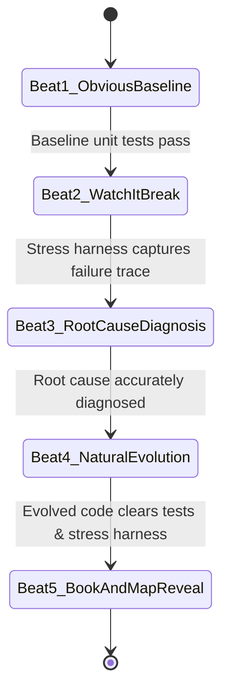
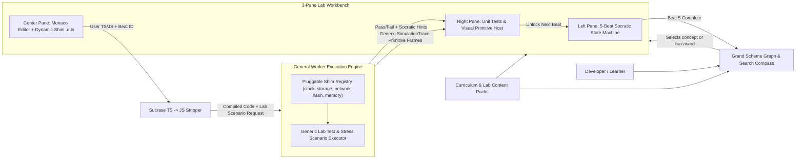

# MVP Product & Technical Implementation Specification
## First-Principles Engineering Book Workbench

> **Document Scope:** General, book-agnostic MVP product architecture, pedagogical state machine, composable visual harness engine, pluggable virtual shim registry, TypeScript data contracts, and phased implementation roadmap.  
> **Content Philosophy:** The platform is designed as a general **Book-to-Intuition Workbench** capable of hosting curricula from any foundational computer science or engineering textbook *(e.g., Designing Data-Intensive Applications [DDIA], Operating Systems: Three Easy Pieces [OSTEP], Database Internals, Computer Networking: A Top-Down Approach, SICP)*. Specific book topics and labs presented in Section 4 serve as **illustrative seed examples** demonstrating how diverse engineering domains map onto the platform's general primitives.

---

## 1. Product Overview & Core Thesis

### 1.1 Target Audience
- **Working Software Engineers** who routinely encounter production buzzwords on the job and want deep structural intuition rather than copy-pasted recipes.
- **Systems & Application Developers** looking to bridge fragmented practical experience with cohesive, textbook-grade mental models.
- **CS Graduates & Learners** transitioning from theoretical university coursework into production system constraints and trade-offs.

### 1.2 The Problem
Developer learning currently fractures across three incomplete approaches:

1. **Fragmented Day-to-Day Learning (Random Googling):**  
   Engineers learn isolated concepts when debugging an incident or reading a pull request. They learn *how* to configure a tool or apply a pattern, but lack a mental map of **where that concept sits in the grand scheme of computer science**, which fundamental constraint birthed it, or which sibling trade-offs surround it.
2. **Passive Textbook Reading:**  
   Foundational books *(e.g., DDIA, OSTEP, Database Internals)* excel because they organize knowledge as a causal hierarchy (Problem → Naive Approach → Breaking Point → Refined Architecture). However, reading chapters passively without implementing and stress-testing the mechanisms leads to shallow retention.
3. **Forceful Coding Platforms:**  
   Many interactive coding tools hand learners named algorithms up front (e.g., *"Step 3: Implement Algorithm X"*). Forcing a textbook blueprint prematurely turns learning into mechanical translation—developers memorize recipes without viscerally understanding *why* simpler approaches failed.

### 1.3 The Solution
A general **First-Principles Engineering Workbench** uniting two core experiences:
1. **The "Grand Scheme" Knowledge Graph & Concept Compass:** Maps pluggable textbook curricula into a causal dependency graph. Learners can explore top-down by book structure or search bottom-up for any term encountered at work to locate its parent principles, prerequisites, trade-offs, and interactive labs.
2. **The Intuitive 5-Beat Discovery Workbench ("Intuition First, Jargon Last"):** Rather than prescribing named algorithms upfront, any concept pack guides learners through a **5-beat discovery loop**—write the obvious baseline, watch it break under realistic stress inside a live visual harness, diagnose the root cause, evolve the code naturally, and unlock the formal textbook name and Grand Scheme anchor only after achieving the insight.

---

## 2. Pedagogical Engine: The 5-Beat Intuitive Discovery Loop

Every interactive lab is executed by a unified **"Intuition First, Jargon Last"** state machine. Formal terminology and textbook citations are masked during Beats 1–4 and unlocked in Beat 5 once the learner has built and validated the mechanism.



### Beat 1 — The Obvious Baseline
- **Goal:** Present a concrete, jargon-free engineering goal solvable with basic programming primitives (counters, lists, maps, loops, arithmetic).
- **Guardrail:** Zero textbook buzzwords appear in the problem statement, function names, or starter comments.
- **Exit Criteria:** User code passes functional baseline unit tests proving it works under normal/small-scale conditions.

### Beat 2 — Watch It Break (Code-Driven Visual Stress Harness)
- **Goal:** Demonstrate *why* the obvious baseline fails under realistic operational pressure (traffic bursts, scale growth, hardware faults, concurrency, or resource exhaustion) by executing the **learner's own code** inside a deterministic simulator.
- **Mechanism:** The user triggers **"Run Production Stress"** in the visual harness. Their compiled baseline runs across simulated time, workload scale, or fault injections, rendering real-time visual telemetry that highlights the failure signature.
- **Exit Criteria:** The simulator detects the target bottleneck or failure invariant and records trace evidence for the learner to inspect.

### Beat 3 — Intuitive Root-Cause Diagnosis
- **Goal:** Prevent blind trial-and-error edits by connecting the visual failure trace directly to its structural cause.
- **Mechanism:** Before Beat 4 code instructions unlock, an interactive **Root-Cause Diagnosis Card** presents plausible plain-English hypotheses. Incorrect choices return Socratic hints pointing back to metrics observed in Beat 2.
- **Exit Criteria:** Learner selects the root cause explaining why their baseline broke.

### Beat 4 — The Natural Code Evolution
- **Goal:** Guide the learner to make the smallest, most natural conceptual modification to their *own* Beat 1 code to resolve the diagnosed bottleneck.
- **Mechanism:** Instead of naming a textbook algorithm, the prompt offers an intuitive design nudge directly derived from Beat 3 (cause-and-effect reasoning).
- **Exit Criteria:** The evolved code passes both **Tab A (Behavioral Unit Tests)** and **Tab B (Visual Stress Harness)** on the exact scenario that broke Beat 1.

### Beat 5 — The "Grand Scheme" & Book Reveal
- **Goal:** Connect the user's working intuition to formal engineering vocabulary, textbook foundations, and real-world architecture.
- **Mechanism:** Unlocks the **Concept Reveal Card** containing:
  1. **Formal Industry Name(s)** and relationship to adjacent variations.
  2. **Curated Book Anchors** *(e.g., book chapter, section summary, core equations/trade-offs)*.
  3. **Production Infrastructure Examples** (where the mechanism appears in real systems).
  4. **Grand Scheme Node Unlock:** Marks the concept node as **Mastered** on the Knowledge Graph and highlights downstream concepts unlocked by this understanding.

---

## 3. Core Platform Architecture (MVP)

The MVP pairs a content-agnostic Knowledge Graph Explorer with a data-driven 3-Pane Lab Workbench, persisted locally (`localStorage` via Zustand) and cleanly extensible to multi-book content packs or backend storage later.

### 3.1 Module 1: The "Grand Scheme" Knowledge Graph & Concept Compass

1. **Pluggable Book Curriculum Tree (`React Flow` + `Dagre`):**
   - Renders any loaded `BookCurriculum` pack as a zoomable, auto-laid-out Directed Acyclic Graph (DAG) grouped by curriculum-defined conceptual layers (e.g., *Storage*, *Concurrency*, *Networking*, *Distribution*, *Resilience*).
   - Node states: `locked` / `available` (interactive lab ready) / `in_progress` (displays current Beat `1..5`) / `mastered` / `preview` (informational map nodes giving topological context even before interactive labs are authored for every topic).
   - Edge semantics:
     - `prerequisite` (*"Foundational mental model for..."*)
     - `evolves_into` (*"Breaks under pressure, motivating..."*)
     - `tradeoff` (*"Design alternative trading X for Y..."*)

2. **Bottom-Up "Where Does This Fit?" Search Compass:**
   - Global search bar indexed over formal titles, plain-English intuition titles, symptom keywords, and industry aliases (`SearchAlias`).
   - Selecting any searched term smoothly pans and zooms the graph to the corresponding node and opens a **Concept Context Drawer** answering:
     1. *Where does this fall in the grand scheme?* (Book $\rightarrow$ Domain/Chapter $\rightarrow$ Parent Problem)
     2. *What forced it to exist?* (Upstream bottleneck)
     3. *What are its trade-offs & siblings?* (Connected alternative nodes)
     4. *Action:* **"Discover From First Principles"** (launches the 5-Beat Lab if available, or inspects curated summary context).

### 3.2 Module 2: The 3-Pane First-Principles Lab Workbench

Any concept carrying a `LabDefinition` opens inside a unified 3-pane workbench:

| Pane | Component | Responsibility |
| :--- | :--- | :--- |
| **Left Pane** | **Socratic Narrative & Beat Stepper** | Displays Beats `1..5`, hides formal jargon until Beat 5, hosts the Beat 3 Diagnosis Card, provides progressive Socratic hints, and renders the Beat 5 Book & Map Reveal. |
| **Center Pane** | **Zero-Boilerplate Code Editor** | Embedded **Monaco Editor** (TypeScript/JavaScript) pre-populated with minimal scaffolding and ambient `.d.ts` definitions injected from the lab's declared virtual shims. |
| **Right Pane** | **Dual Verification Engine** | **Tab A — Progressive Behavioral Checks:** Runs declarative unit tests and surfaces Socratic hints on failure.<br>**Tab B — Composable Visual Stress Harness:** Feeds deterministic simulation scenarios through the user's code and renders live interactive telemetry via shared visualization primitives. |

### 3.3 Pluggable Virtual Shim Registry & Composable Visual Harness Primitives

To avoid building bespoke, one-off sandboxes and visualizers for every single book chapter, the platform exposes two general extension layers:

#### A. Pluggable Virtual Shim Registry (`shimRegistry`)
Each lab declares `requiredShims: ShimId[]`. The Web Worker automatically instantiates instrumented mock environments, injects their TypeScript `.d.ts` ambient types into Monaco, and captures fine-grained telemetry calls without requiring real OS/network/disk I/O:
- **`clock`:** Deterministic virtual clock (`now()`, `advance(ms)`) so time-sensitive systems run instantaneously and reproducibly.
- **`storage`:** Instrumented virtual byte-log / block device (`append()`, `readAt()`, `scanAll()`, `rewriteCompacted()`, `totalBytes()`) tracking exact read/write hop counts and space amplification.
- **`network`:** Virtual cluster transport (`send()`, `partition()`, `drop()`, `setLatency()`) for consensus, replication, and retry behaviors.
- **`hash`:** Deterministic 32-bit unsigned integer hash helpers (`hash(input)`) so partitioning/bloom-filter labs behave consistently.
- **`memory`:** Simulated bounded frame/cache store (`get()`, `set()`, `evict()`, capacity tracking) for caching, paging, and buffer-pool labs.

#### B. Composable Visual Harness Primitives (`visualizers/primitives`)
Instead of writing isolated visual engines from scratch, labs specify a `visualizerConfig` composed of reusable, trace-driven visual components fed by `SimulationTrace` frames:
1. **`timeline_stream`:** Chronological bar/event stream (requests allowed vs. blocked, packet deliveries, retry bursts, latency spikes over virtual time).
2. **`state_xray`:** Live memory/disk inspection strip (in-memory tables, sequential log blocks, cache slots, queue depth, active vs. stale entries).
3. **`topology_graph`:** Structural cluster/ring/tree view (nodes, circular key rings, leader/follower links, live fault injection toggles like *"Kill Node"* or *"Partition Link"*, plus key/traffic migration deltas).
4. **`metric_gauge`:** Real-time threshold gauges & KPIs (DB health load %, read hops per query, cache miss ratio, SLA status).

---

## 4. Universal Lab Authoring Blueprint & Illustrative Examples

### 4.1 General 5-Beat Lab Authoring Blueprint
Any chapter concept from any engineering book can be added as a data-driven module using the following structure:

1. **Curriculum Placement (`ConceptNode` + `ConceptEdge`):** Define where the concept sits in a `BookCurriculum`, its upstream problem, sibling trade-offs, and searchable `SearchAlias` terms.
2. **Code Contract & Shims:** Pick `requiredShims` (e.g., `["clock"]` or `["storage"]`) and author a clean, boilerplate-free TypeScript class/function skeleton in `Beat 1` using plain domain vocabulary.
3. **Behavioral Unit Tests (`UnitTestSpec[]`):** Write small deterministic tests tagged with `minBeat: 1` (sanity) and `minBeat: 4` (evolved invariant), each paired with a Socratic hint.
4. **Adversarial Stress Scenario (`stressScenario`):** Define a workload that passes Beat 1 sanity tests yet violates an operational invariant (burst overload, $O(N)$ degradation, fault amplification) and emits structured `SimulationTrace` frames for the declared `visualizerConfig` primitives.
5. **Beat 3 Diagnosis & Beat 5 Reveal:** Author 3–4 plain-English hypotheses for Beat 3 and the formal name, book excerpts *(suggestive references)*, and real-world system citations for Beat 5.

---

### 4.2 Illustrative Reference Examples (MVP Seed Pack)

The following three examples demonstrate how completely different systems domains—**Traffic Control**, **Storage Engines**, and **Distributed Partitioning**—run cleanly on the exact same 5-Beat platform engine, shim registry, and composable visual primitives.

#### Example 1: Traffic Control & Backpressure
*Suggestive Book Context: Systems Resilience & Service Protection (e.g., DDIA Ch. 1 Reliability / Computer Networking Traffic Shaping)*  
*Search Aliases:* `"rate limiting"`, `"429"`, `"throttling"`, `"token bucket"`, `"burst traffic"`, `"backpressure"`  
*Platform Mapping:* `requiredShims: ["clock"]` | `visualizerConfig: ["timeline_stream", "metric_gauge"]`

- **Code Contract:**
  ```ts
  export class RequestGuard {
    constructor(maxPerMinute: number, clock: Clock) {}
    allowRequest(clientId: string): boolean { return true; }
  }
  ```
- **5-Beat Walkthrough:**
  - **Beat 1 (Baseline):** Protect a downstream service capped at `10` requests/min using the simplest check (e.g., bucket by `Math.floor(clock.now() / 60000)`). Passes basic allow/block/isolation unit tests.
  - **Beat 2 (Stress — `timeline_stream` + `metric_gauge`):** Fires `10` requests at `00:59` (`59,000ms`) and `10` at `01:01` (`61,000ms`). Both minutes pass `<= 10`, yet `20` requests strike the database inside `2` seconds, pushing the `metric_gauge` to `200%` (**OVERLOAD CRASH**).
  - **Beat 3 (Diagnosis):** Identify why `20` requests passed in `2s`: *all quota resets instantaneously at the `:00` minute boundary*.
  - **Beat 4 (Natural Evolution):** Instead of resetting all `10` slots at `:00`, replenish slots continuously over elapsed time (`1` slot every `6s`, capped at `maxPerMinute`). Clears both boundary-burst unit tests and the stress timeline.
  - **Beat 5 (Reveal):** **Token Bucket Algorithm** *(contrasted with Fixed Window & Sliding Window)* + curated book notes + usage in Envoy, Stripe, and API Gateways.

---

#### Example 2: Storage Engines & Fast Retrieval
*Suggestive Book Context: Data Storage & Indexing (e.g., DDIA Ch. 3 "Storage and Retrieval" / Database Internals)*  
*Search Aliases:* `"database index"`, `"append-only log"`, `"SSTable"`, `"LSM-tree"`, `"Bitcask"`, `"compaction"`, `"disk seek"`  
*Platform Mapping:* `requiredShims: ["storage"]` | `visualizerConfig: ["state_xray", "metric_gauge"]`

- **Code Contract:**
  ```ts
  export class MiniKVStore {
    constructor(disk: VirtualDisk) {}
    set(key: string, value: string): void {}
    get(key: string): string | null { return null; }
    compact(): void {}
  }
  ```
- **5-Beat Walkthrough:**
  - **Beat 1 (Baseline):** Make writes fast by appending `{ key, value }` to `disk`, and implement `get(key)` by scanning `disk.scanAll()` backwards for the latest entry. Passes correctness unit tests.
  - **Beat 2 (Stress — `state_xray` + `metric_gauge`):** Runs `2,000` updates across `100` hot keys followed by `20` reads. The `state_xray` block strip shows `2,000` stale records piling up on disk while each `get()` performs an animated full $O(N)$ scan (`40,000` total disk reads $\rightarrow$ **READ SLA BREACH + DISK BLOAT**).
  - **Beat 3 (Diagnosis):** Identify why reads slowed down and disk swelled: *nothing in memory remembers each key's latest byte offset, and stale overwrites remain on disk*.
  - **Beat 4 (Natural Evolution):** Maintain an in-memory `Map<string, number>` mapping `key -> byteOffset` returned by `disk.append()` so `get()` uses `disk.readAt(offset)` in 1 hop, and implement `compact()` via `disk.rewriteCompacted(...)` to collapse stale overwrites.
  - **Beat 5 (Reveal):** **Hash-Indexed Append-Only Log (Bitcask Pattern) & Log Compaction** *(bridging toward SSTables & LSM-Trees)* + curated book notes + usage in Riak, RocksDB, Kafka, Cassandra.

---

#### Example 3: Distributed Data Partitioning
*Suggestive Book Context: Scalability & Horizontal Sharding (e.g., DDIA Ch. 6 "Partitioning" / Distributed Systems)*  
*Search Aliases:* `"consistent hashing"`, `"sharding"`, `"virtual nodes"`, `"cache stampede"`, `"rebalancing"`, `"modulo hashing"`  
*Platform Mapping:* `requiredShims: ["hash"]` | `visualizerConfig: ["topology_graph", "metric_gauge"]`

- **Code Contract:**
  ```ts
  export class ClusterRouter {
    constructor(initialNodes: string[], helper: PartitionHelper) {}
    addNode(nodeId: string): void {}
    removeNode(nodeId: string): void {}
    routeKey(key: string): string | null { return null; }
  }
  ```
- **5-Beat Walkthrough:**
  - **Beat 1 (Baseline):** Route keys across active nodes with `nodes[helper.hash(key) % nodes.length]`. Passes determinism and even-spread unit tests across 4 nodes.
  - **Beat 2 (Stress — `topology_graph` + `metric_gauge`):** Populates `1,000` keys across `4` nodes and triggers **"Kill Node 3"** (`removeNode("node-3")`). The topology delta shows ~`75%` of all keys abruptly migrating between surviving nodes, spiking the miss gauge (**75% CACHE MISS / DATABASE STAMPEDE**).
  - **Beat 3 (Diagnosis):** Identify why healthy nodes lost ~75% of their keys: *shrinking `nodes.length` from `4` to `3` alters the `% N` divisor and scrambles almost every key's remainder*.
  - **Beat 4 (Natural Evolution):** Map both keys and multiple replicas of each server (`nodeId + "#" + i`) onto a fixed circular space (`0 .. 2^32 - 1`), routing each key clockwise to the next node point (wrapping around at the end). Removing one node only shifts keys owned by that slice (`~25%`).
  - **Beat 5 (Reveal):** **Consistent Hashing with Virtual Nodes** + curated book notes + usage in DynamoDB, Cassandra, Discord, NGINX/Envoy ring hashing.

---

## 5. Technical Stack, Generic Data Contracts & Architecture

### 5.1 Recommended Tech Stack (MVP)
- **Framework:** Next.js 15 (App Router) + React 19 + TypeScript (strict mode)
- **Styling & Icons:** Tailwind CSS + Lucide Icons (high-contrast dark engineering workbench UI)
- **Knowledge Graph Canvas:** `@xyflow/react` + `@dagrejs/dagre` (automatic DAG layout for any curriculum pack)
- **In-Browser Code Editor:** `@monaco-editor/react` (with dynamic `.d.ts` ambient type injection matching each lab's `requiredShims`)
- **In-Browser Compilation:** `sucrase` (pure JS, `<10ms` TypeScript-to-JavaScript stripping with zero WASM startup overhead)
- **Execution Sandbox:** Native Browser **Web Worker** running off-thread with a `1500ms` infinite-loop timeout watchdog, instantiating shims via the general `shimRegistry`
- **Visual Harness:** Shared composable primitive components (`timeline_stream`, `state_xray`, `topology_graph`, `metric_gauge`) rendered strictly from worker-emitted `SimulationTrace` frames
- **State Persistence:** Zustand + `localStorage` persistence for multi-curriculum Beat progress, saved drafts, and mastered nodes

### 5.2 System Architecture Diagram



### 5.3 Generic TypeScript Data Contracts (`src/types/workbench.ts`)

```ts
export type LabBeatNumber = 1 | 2 | 3 | 4 | 5;

export type NodeStatus = "locked" | "available" | "in_progress" | "mastered" | "preview";

export type EdgeRelationType = "prerequisite" | "evolves_into" | "tradeoff";

export type ShimId = "clock" | "storage" | "network" | "hash" | "memory";

export type VisualizerPrimitiveType =
  | "timeline_stream"
  | "state_xray"
  | "topology_graph"
  | "metric_gauge";

export interface BookReference {
  bookId: string;
  bookTitle: string;           // Suggestive book citation (e.g. "Systems Architecture / DDIA")
  chapterLabel: string;        // e.g. "Storage and Retrieval — Indexing"
  sectionSummary: string;
  keyTakeaways: string[];
  productionSystems: string[];
}

export interface SearchAlias {
  term: string;                // Industry term, symptom, or buzzword
  contextHint: string;
}

export interface ConceptNode {
  id: string;
  title: string;               // Formal name (masked inside lab until Beat 5)
  intuitionTitle: string;      // Plain-English problem framing
  domain: string;              // Curriculum-defined category (e.g. "storage", "resilience", "os")
  summary: string;
  whyItExists: string;
  tradeoffs: string[];
  aliases: SearchAlias[];
  bookRefs: BookReference[];
  labId?: string;
}

export interface ConceptEdge {
  id: string;
  source: string;
  target: string;
  relation: EdgeRelationType;
  label: string;
}

export interface BookCurriculum {
  id: string;
  title: string;
  subtitle: string;
  domainColors: Record<string, string>;
  nodes: ConceptNode[];
  edges: ConceptEdge[];
}

export interface DiagnosisOption {
  id: string;
  label: string;
  isCorrect: boolean;
  feedback: string;
}

export interface DiagnosisPrompt {
  question: string;
  options: DiagnosisOption[];
}

export interface UnitTestSpec {
  id: string;
  name: string;
  description: string;
  minBeat: 1 | 4;
  socraticHint: string;
}

export interface VisualizerPrimitiveConfig {
  type: VisualizerPrimitiveType;
  title: string;
  options?: Record<string, unknown>;
}

export interface VisualizerConfig {
  layout: "stacked" | "split";
  interactiveControls?: Array<{
    paramKey: string;
    label: string;
    controlType: "button" | "slider" | "select";
    defaultValue: number | string | boolean;
  }>;
  primitives: VisualizerPrimitiveConfig[];
}

export interface LabBeatSpec {
  beat: LabBeatNumber;
  title: string;
  narrativeMarkdown: string;
  instructions: string;
  starterCode?: string;
  diagnosis?: DiagnosisPrompt;
  stressScenarioId?: string;
  revealContent?: {
    formalConceptName: string;
    whatYouInventedSummary: string;
    bookRefs: BookReference[];
    nextSuggestedNodes: string[];
  };
}

export interface LabDefinition {
  id: string;
  conceptNodeId: string;
  title: string;
  requiredShims: ShimId[];
  visualizerConfig: VisualizerConfig;
  scenarioModuleId: string;    // Registered test & stress scenario adapter ID
  beats: Record<LabBeatNumber, LabBeatSpec>;
  unitTests: UnitTestSpec[];
}

export interface WorkerExecutionRequest {
  requestId: string;
  labId: string;
  beat: LabBeatNumber;
  userCode: string;
  mode: "unit_tests" | "stress_simulation";
  simulationParams?: Record<string, number | string | boolean>;
}

export interface UnitTestResult {
  testId: string;
  name: string;
  passed: boolean;
  message: string;
  socraticHint?: string;
}

export interface VisualizerMetric {
  label: string;
  value: string | number;
  status: "healthy" | "warning" | "critical";
}

export interface PrimitiveTracePayload {
  primitive: VisualizerPrimitiveType;
  data: Record<string, unknown>;
}

export interface SimulationTrace {
  scenarioName: string;
  failedAsExpectedInBeat2?: boolean;
  passedStressInBeat4?: boolean;
  headlineAlert?: {
    severity: "healthy" | "critical";
    title: string;
    detail: string;
  };
  metrics: VisualizerMetric[];
  primitivePayloads: PrimitiveTracePayload[];
}

export interface WorkerExecutionResult {
  requestId: string;
  compileError?: string;
  runtimeError?: string;
  timedOut?: boolean;
  executionMs: number;
  unitTestResults?: UnitTestResult[];
  allTestsPassed?: boolean;
  simulationTrace?: SimulationTrace;
}
```

### 5.4 Proposed Project File Tree

```text
sat-hackathon/
├── doc.md                                      # General MVP specification
├── package.json
├── tsconfig.json
├── next.config.ts
└── src/
    ├── app/
    │   ├── layout.tsx                          # Dark engineering theme & fonts
    │   ├── page.tsx                            # Grand Scheme Knowledge Graph & Search Compass
    │   └── labs/
    │       └── [labId]/
    │           └── page.tsx                    # Data-driven 3-Pane Discovery Workbench
    ├── types/
    │   └── workbench.ts                        # General platform & worker data contracts
    ├── store/
    │   └── useWorkbenchStore.ts                # Zustand multi-curriculum progress & drafts store
    ├── engine/
    │   ├── compiler.ts                         # Sucrase TS->JS stripper
    │   ├── workerClient.ts                     # Promise wrapper + 1.5s infinite-loop watchdog
    │   └── worker/
    │       ├── sandbox.worker.ts               # Isolated Web Worker entrypoint
    │       ├── shimRegistry.ts                 # Pluggable shims + dynamic .d.ts type generator
    │       ├── labExecutor.ts                  # Generic unit test & stress scenario dispatcher
    │       └── scenarios/                      # Registered scenario adapters per lab module
    │           ├── index.ts                    # Scenario adapter registry
    │           ├── rateLimiterScenario.ts      # Example scenario adapter 1
    │           ├── storageEngineScenario.ts    # Example scenario adapter 2
    │           └── consistentHashScenario.ts   # Example scenario adapter 3
    ├── components/
    │   ├── graph/
    │   │   ├── KnowledgeGraphCanvas.tsx        # React Flow + Dagre curriculum map
    │   │   ├── ConceptNodeCard.tsx             # Mastery & Beat badge node card
    │   │   ├── ConceptSearchCompass.tsx        # "Where Does This Fit?" fuzzy buzzword search
    │   │   └── ConceptContextDrawer.tsx        # Prerequisites, trade-offs, Lab launcher
    │   ├── workbench/
    │   │   ├── LabWorkbenchLayout.tsx          # 3-pane layout + 5-Beat stepper
    │   │   ├── NarrativeBeatPane.tsx           # Progressive jargon-free Socratic pane & Beat 5 reveal
    │   │   ├── MonacoLabEditor.tsx             # Monaco editor with auto-injected shim .d.ts
    │   │   └── VerificationRightPane.tsx       # Unit test runner + Visual Primitive Host
    │   └── visualizers/
    │       ├── VisualizerHost.tsx              # Composes primitives declaratively from VisualizerConfig
    │       └── primitives/
    │           ├── TimelineStreamPrimitive.tsx # Chronological event/burst stream renderer
    │           ├── StateXRayPrimitive.tsx      # Memory/disk blocks, tables & scan hop renderer
    │           ├── TopologyGraphPrimitive.tsx  # Rings/clusters, fault injection & delta renderer
    │           └── MetricGaugePrimitive.tsx    # Threshold gauges & KPI cards
    ├── content/                                # Pluggable curricula & lab definitions (example seed pack)
    │   ├── registry.ts                         # Loads active curricula & labs into the platform
    │   ├── curricula/
    │   │   └── seedSystemsCurriculum.ts        # Example systems curriculum DAG & book references
    │   └── labs/
    │       └── examples/
    │           ├── rateLimiterLab.ts           # Illustrative Example 1
    │           ├── storageEngineLab.ts         # Illustrative Example 2
    │           └── consistentHashLab.ts        # Illustrative Example 3
    └── tests/
        └── platformAndExamples.test.ts         # Verifies shim registry, executor & example scenarios
```

---

## 6. MVP Implementation Roadmap & Verification Strategy

### Phase 1: Project Scaffolding & General Type Contracts
- Initialize Next.js 15 (App Router, TypeScript, Tailwind CSS) with `@xyflow/react`, `@dagrejs/dagre`, `@monaco-editor/react`, `sucrase`, `zustand`, and `lucide-react`.
- Implement `src/types/workbench.ts` and `src/store/useWorkbenchStore.ts` to manage multi-curriculum state, per-Beat progress, and saved code drafts cleanly.

### Phase 2: "Grand Scheme" Knowledge Graph & Concept Compass
- Build `KnowledgeGraphCanvas.tsx`, `ConceptNodeCard.tsx`, `ConceptSearchCompass.tsx`, and `ConceptContextDrawer.tsx` driven completely by `BookCurriculum` JSON/TS data packs.
- Seed `src/content/curricula/seedSystemsCurriculum.ts` with ~14–16 interconnected nodes and suggestive textbook anchors as the MVP sample curriculum.

### Phase 3: General Web Worker Sandbox, Shim Registry & Lab Executor
- Implement `compiler.ts` (Sucrase), `sandbox.worker.ts` (with `1500ms` watchdog), `shimRegistry.ts` (providing `clock`, `storage`, `network`, `hash`, `memory` shims + Monaco `.d.ts` bundles), and `labExecutor.ts`.
- Register the 3 illustrative example scenario adapters (`rateLimiterScenario.ts`, `storageEngineScenario.ts`, `consistentHashScenario.ts`) against the generic executor contract.

### Phase 4: Data-Driven 3-Pane Workbench & 5-Beat UI
- Build `LabWorkbenchLayout.tsx`, `NarrativeBeatPane.tsx` (enforcing Beat 1–4 jargon masking, Beat 3 interactive Diagnosis Card, and Beat 5 reveal), `MonacoLabEditor.tsx`, and `VerificationRightPane.tsx`.

### Phase 5: Composable Visual Harness Primitives & Seed Lab Packs
- Build the shared primitives (`TimelineStreamPrimitive.tsx`, `StateXRayPrimitive.tsx`, `TopologyGraphPrimitive.tsx`, `MetricGaugePrimitive.tsx`) and `VisualizerHost.tsx`.
- Author the 3 illustrative example labs under `src/content/labs/examples/` wired purely through declarative `LabDefinition` objects.

### Phase 6: Automated Tests & End-to-End Platform Verification
- **Automated Verification:** Run `npx tsc --noEmit`, `npm run build`, and `src/tests/platformAndExamples.test.ts` validating the shim registry, timeout safety, Beat 1 baseline failures in Beat 2, and Beat 4 reference solutions passing both unit tests and stress invariants.
- **Manual Walkthrough:** Test searching random buzzwords in the Concept Compass, jumping directly to nodes on the graph, completing an illustrative lab from Beat 1 $\rightarrow$ Beat 5, and confirming that the Knowledge Graph updates node status to `mastered`.
